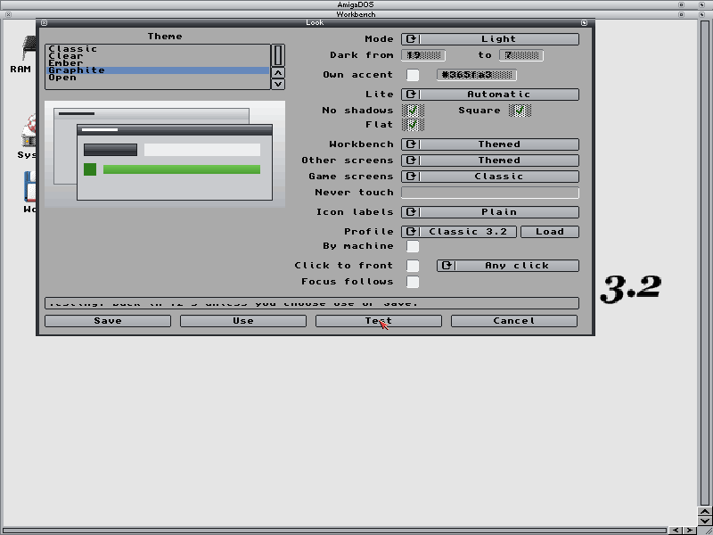
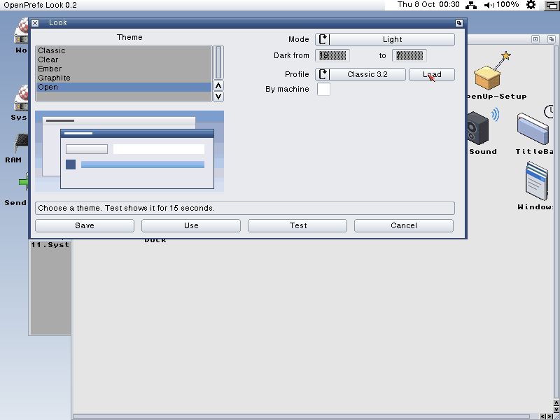

# OpenPrefs Look

The editor for OpenLook, the OpenGadTools look on Workbench and every
GadTools program. OpenLook draws; Look sets what it draws. MIT, Copyright
(c) 2026 Dalsin Limited.

## 0.1 (6 October 2026)

| Setting | Where it goes |
| --- | --- |
| Theme, from `SYS:Prefs/Presets/Themes`, with a preview | First line of `ENV:OpenGadTools/Look` |
| Light, dark, or by the clock (dark from/to) | First line, and `mode auto 19 7` |
| Own accent (`#rrggbb`) | `accent` |
| Lite: automatic (on for a real 68040 or 68060 without OpenGPU), on (with no shadows, square, flat), off | `lite`, `lite.shadows`, `lite.rounding`, `lite.gradients` |
| Workbench, other public screens, game screens: themed or Classic | `screen workbench|public|custom` |
| Programs never touched (comma between names) | `never` lines |
| Icon labels: plain, fields, shadow, outline | Font prefs' Workbench icon text (`ENV:Sys/font.prefs`) |
| Desktop profiles: Load one into the editor; By machine lets OpenLook choose at start | `SYS:Prefs/Presets/OpenPrefs/<name>.profile`; `profile auto` |
| Click to front (any click, or with a key), Focus follows (AutoPoint) | The OS's commodities: on at start (copied into `SYS:WBStartup`, ClickToFront's `QUALIFIER` tooltype) and started or stopped now |

Save writes `ENV:` and `ENVARC:`; Use writes `ENV:`; Test writes `ENV:` and
puts it back after 15 seconds unless Use or Save follows; Cancel puts back
what a Test changed. Each tells OpenLook (Ctrl-F to its port's task), which
redraws the open windows' frames and gadgets. From the Shell:
`Look [FROM file] [USE] [SAVE]`.

The three profiles OpenUp installs: **Modern** (AmigaChrome: Open, dark by
the clock), **Lite 68040** (a real 68040 or 68060: Open, Lite) and
**Classic 3.2** (any machine: the OS's own look). A profile is OpenLook's
prefs format with `target` lines (opengadtools DESIGN.md section 2i).

Holding Shift while OpenLook starts gives the OS's own look until the look
is changed again (safe start).

**Views (0.2).** Look opens in Simple: the theme with its preview, the mode,
and the profiles. View > Advanced (Amiga-A, or `ADVANCED` from the Shell)
shows every setting. The choice is shared by all OpenPrefs editors as
`simple` or `advanced` in `ENV:OpenAmiga/PrefsView` (and `ENVARC:`).

**Started from Workbench (8 October 2026).** A double-click on Look's
icon, or Tools > Preferences > Look, opened an empty console window first,
and Look's own window only once that console was closed. The cause: Look
is built with libnix, which gives a program started from Workbench a
console (`CON://///AUTO/CLOSE/WAIT`) as its input and output, and Look
called `ReadArgs()` at every start; with no command line, `ReadArgs()`
reads the arguments from the input, which opened the console and waited
on it. Now the arguments are read only from the Shell (`argc` above 0),
as OpenUp Setup already did, and the commands Look runs itself (copying
ClickToFront or AutoPoint into `WBStartup`, starting them) get `NIL:` for
their input and output. The same `ReadArgs()` fix went into Title bar,
Windows, Sound, Menus and OpenTypes, which had the same console. Tested on
a scratch OS 3.2.3: Look opened from its icon, from OpenTitle's cog and
from Menus' Look... button, each with no console.

## 0.3 (8 October 2026): the approved look

- **Windows**, three switches in the Simple view, for OpenLook 0.5:
  "Scroll bars when needed" (`scrollers auto`), "No size gadget"
  (`sizegadget off`; OpenWindows 0.5 resizes from the edges) and "No zoom
  gadget" (`zoom off`; a double-click on a title bar brings a window to the
  front). The lines are written with the others, and kept when Look saves.
- **The Modern and Lite 68040 profiles** turn all three on: that is the look
  approved on the canvas. Classic 3.2 leaves them off.
- **The Open theme is now flat** (opengadtools: OpenLook 0.5), so the
  default accent is its blue, `#2f6fb3`; the old glassy Open is Glass.

Not yet built on the os32 stove.

## OpenLook 1.1 plan (12 October 2026): Appearance

The combined preferences design (`docs/combined-prefs/DESIGN.md`, revision
of 10 October) makes OpenLook's editor the Appearance editor, P1 of that
design. This is the plan; the sections after it say what was built.

**Tabs.** OpenLook 1.0 has four: Look, Windows, Title bar, Menus. 1.1 adds
six, in the design's order, and names Look's tab Theme:

| Tab | File it reads and writes | What it sets |
| --- | --- | --- |
| Theme | `ENV:OpenGadTools/Look` | As Look does today |
| Pointer | `ENV:Sys/pointer.prefs` | The pointer images (Normal, Busy and the other types the OS 3.2 file holds), from the sets in `SYS:Prefs/Presets/Pointers`, with a preview and the hot spot |
| Fonts | `ENV:Sys/font.prefs` | The screen font, the icon font, the system (fixed-width) font, the icon labels' style and pens |
| Colours | `ENV:Sys/palette.prefs` | The first eight colours, and in Advanced the pens of 4-colour and 8-colour screens |
| Backdrops | `ENV:Sys/wbpattern.prefs` | A picture for the Workbench, drawers and screen, how it is placed, remapped and dithered |
| Workbench | `ENV:Sys/workbench.prefs` | Icon borders, label length, the disk gauge, the title bar and its text, icon support, stack, lists, copying |
| File requesters | `ENV:Sys/asl.prefs` | How files are sorted, where the requester opens and how big |

Windows, Title bar and Menus stay as they are.

**One PREF reader and writer.** `Look/src/pf_iff.c` holds a PREF file as
its list of chunks in file order, PRHD first; `pf_prefs.c` reads and
writes the fields of each OS format inside a chunk's bytes, leaving every
byte it has no field for as it was. `pf_amiga.c` loads and saves the list
with iffparse.library (`ParseIFF()` in raw steps; `PushChunk()`,
`WriteChunkBytes()`, `PopChunk()`). A chunk no tab knows (the 3.2 Workbench
file's hidden devices, a newer release's chunks) is carried across as it
came. Both are plain C, so `Look/tests/run.sh` tests them on the host, as
Dock, Menus and Sound are tested: every sample file reads and writes back
byte for byte, each field change touches only its own bytes.

**Only what changed is written.** A tab writes its file only when the bytes
it would write differ from the file's (ENV: for Use and Test, ENV: and
ENVARC: for Save). Changing a font leaves the palette, pointer and backdrop
files untouched, and the Theme tab writes `font.prefs` only when the icon
labels' style changed.

**The frame.** The six new tabs share one frame (`Look/src/appearance.c`):
the tabs, the page, a status line and Save, Use, Test and Cancel, with the
Project and View menus. Save writes ENV: and ENVARC:, Use ENV:, Test ENV:
and puts the file back after 15 seconds unless Use or Save follows, and
Cancel puts back what a Test changed. A click on another tab keeps what was
changed, as Use, as the four pages do today. Intuition and Workbench pick
the files up through IPrefs, as when the OS editors save them; nothing
hooks Workbench beyond what OpenLook already does. The OS editors stay in
`SYS:Prefs/Classic`.

**Simple and Advanced.** Each tab opens in Simple with its two to five
most used settings (the screen and icon fonts; the eight colours; the
Workbench picture and how it is placed; the pointer set), and View >
Advanced (Amiga-A) shows every setting, shared as now through
`ENV:OpenAmiga/PrefsView`.

**640 x 256.** The tabs wrap into two rows when one row can't hold them
(the ten names in Topaz 8 need about 850 pixels); the row with the open tab
sits next to the page, as on other systems with two rows of tabs. Each new
tab lays out in two columns inside the 620-pixel width the editor has
today, and no taller than the Theme tab's Simple view; when the window is
already taller, the status line and buttons go to its foot. On a screen
under 400 lines the Theme tab's preview gets shorter, so its Simple view
fits a 256-line screen.

**Pointer acceleration** is not in 1.1. OpenMouseAccel (openamigaup
`src/openmouseaccel/`) keeps `ENV:OpenUp/OpenMouseAccel.prefs`, OpenInput's
design (`Design-Pointer-Acceleration.md`) names other keys in
`ENV:OpenInput/`, and nothing reads either yet; which file, and how it
meets the OS's own accelerated mouse, needs a decision first (question 2
of the combined design's 10 October revision, and question 3 of OpenInput's
`Design-Pointer-Acceleration.md`).

**Shell.** `OpenLook POINTER`, `FONTS`, `COLOURS`, `BACKDROPS`,
`WORKBENCH` and `FILEREQUESTERS` open on that tab, as `OpenLook WINDOWS`
does; `THEME` is a second name for `LOOK`.

## OpenLook 1.1 (12 October 2026): Appearance, built

OpenLook 1.1 is the plan above, built: ten tabs in one window, Look 0.5 as
its Theme tab, and the six new tabs in `Look/src/appearance.c`. Built with
`Look/build-one.sh` on the os32 stove, no warnings. The stand-alone Look,
Windows, Title bar and Menus and the OpenBench built-ins still build.

| Tab | Simple | Advanced adds |
| --- | --- | --- |
| Pointer | The sets in `SYS:Prefs/Presets/Pointers` (a click takes the whole set), a preview of Normal and Busy | The pointer types the file holds, a preview of one, its hot spot, The set or This one (that type only) |
| Fonts | Screen font, icon font (the ASL font requester) | System (fixed-width) font, icon labels (plain, fields, shadow, outline), label and field colours |
| Colours | The first eight colours, red, green and blue, shown on the screen as they move | The thirteen DrawInfo pens for 4-colour and for 8-colour screens; the OS's own colours |
| Backdrops | For the Workbench, drawers or the screen: the picture (typed or chosen), how it is placed | A picture, the pattern the file had, or nothing; remap, dither, colour match |
| Workbench | Borders round icons, disk gauge, screen title bar, icon label length | NewIcons, colour icons, icon colour precision, lock pens, default stack, drawers in lists, oldest first, keep lists in view, title update, copy buffer, type-ahead, the screen title's text |
| File requesters | Sort by, drawers, order, where it opens | The offset, a size as a share of the window, width and height, always this place and size |

When there is no `palette.prefs`, the Colours tab starts from the colours and
pens the screen has. Bytes no field covers are kept: the icon frame (emboss)
and the hidden devices of `workbench.prefs`, reserved fields, and the
pointer image and colours, which are taken from a set but not drawn here.

**Byte for byte.** OS 3.2.3's own editors were run in the lab on the files
the tabs wrote. Font (its window: Screen Text helvetica 13), and the same
change on the Fonts tab, wrote the same 518 bytes. Read back with `FROM ...
USE`, Font, WBPattern, Workbench, Asl and Palette each wrote the very bytes
the tab had written (a new Workbench picture; borders on; sort by date;
colour 3 changed). A pointer set taken whole is the set's file byte for
byte; Pointer, reading it, writes it with other bytes in its reserved fields
(they hold whatever its memory held) and the hot spot of type 40 limited,
as it does to the set's own file. Host tests (`Look/tests/run.sh`, 125
checks) keep this: Palette's, Workbench's and Asl's files with no file to
start from, Font's helvetica 13, and WBPattern's picture chunk come out
byte for byte.

**Done when** (combined prefs design, P1), in a lab copied from Instance-32:
the theme (Sky to Ember, Theme tab), the screen font (CGTriumvirate 13 to
helvetica 13, Fonts tab) and the Workbench picture
(`Graphite-light-chrome-logo` to `Clear-dark-chrome-logo`, Backdrops tab)
were saved, the lab was stopped and started, and all three were there: the
Ember frames, the screen's title in helvetica, the dark backdrop. The
Classic Font editor (`SYS:Prefs/Classic/Font`) listed Screen Text helvetica
13. Again with the final build: Graphite, CGTimes 13 (from the font
requester) and `Ember-dark-chrome-logo` (from the file requester) were there
after the restart, and Classic Font listed Screen Text CGTimes 13. Save left
the other four Sys files as they were; Use wrote ENV: only; a pointer set
under Test was in `ENV:Sys/pointer.prefs` for 15 seconds and then the file
was back, byte for byte.

**640 x 256.** Measured in the lab on a PAL High Res screen, 640 x 256,
Topaz 8, with the Ember theme (screen bar 18 lines, window title 15): the
six new tabs open 628 pixels wide and, in Simple, 147 (Fonts) to 187
(Colours) lines tall; in Advanced 203 (Pointer) to 239 (Backdrops,
Workbench). The Theme tab's Simple view is 243 lines (it fits, over the last
lines of this theme's taller screen bar); Title bar 241; Menus' Simple 249.
As in 1.0, three pages are bigger than the screen: the Theme and Menus tabs'
Advanced views (taller), and Windows (wider in Topaz 8, for its long switch
labels). On a screen under 400 lines the Windows page now spaces its rows
closer, so its height fits. In OpenLook every page lays its tabs out at
least 600 pixels wide (two rows of five in Topaz 8), so a narrow page like
Title bar gets no third row.

**Fixed on the way.** OpenLook started from a Shell (`Run`, a script)
had the Shell's 4 KB of stack and failed opening its window (software
failure #8000000A); it now asks for 32 KB, as OpenTypes 0.2.3 does. Look
wrote `ENV:Sys/font.prefs` at every Use and Save, which made IPrefs ask to
reset the Workbench screen; it now writes it only when the icon labels'
style changed.

**Found, not changed.**
- At every start `OpenUpTool RECONCILE` makes the icon font the screen
  font and sets the icon labels' colours and shadow from the backdrop's
  tone, writing `ENVARC:Sys/font.prefs` again (and ENV: when Workbench
  isn't open yet; in the lab the icon font became helvetica 13, then
  CGTimes 13, after each restart). On AmigaChrome the icon font and labels
  the Fonts tab sets last until the next start; which of OpenUp and
  OpenLook owns them is still to decide. Its map also still says
  "OpenLook: fonts (to build)" and the like for Font, Palette, Pointer,
  WBPattern, Workbench and Asl.
- IPrefs asks to reset the Workbench screen whenever `font.prefs` changes
  while windows are open, as with the Classic Font editor; on the Team's
  desktop a new font shows from the next start. OpenBench reads its
  backdrop picture when it starts, so a new Workbench picture shows from
  the next start too.

**Still to do.**
- **Pointer acceleration** needs the decision above (which file, and how it
  meets the OS's accelerated mouse).
- Drawing a pointer, and its colours, on the Pointer tab (the design's
  "Draw my own"); the icon frame and hidden devices of `workbench.prefs`
  on the Workbench tab.
- The design's one Simple page for Appearance (theme, mode, accent and
  profile, then text size, backdrop and pointer on the Theme tab), in place
  of each tab's own Simple view; ReAction's look (the 10 October list).
- The Theme tab's Advanced view and the Menus and Windows pages on a
  640 x 256 screen.

## Next

Windows (snapping, Amiga+Tab, wheel under the pointer, remembered window
places, new-drawer defaults), then OpenMenus. The frame and title geometry
(theme format 2) and one text-size scale follow the OpenPrefs page.
