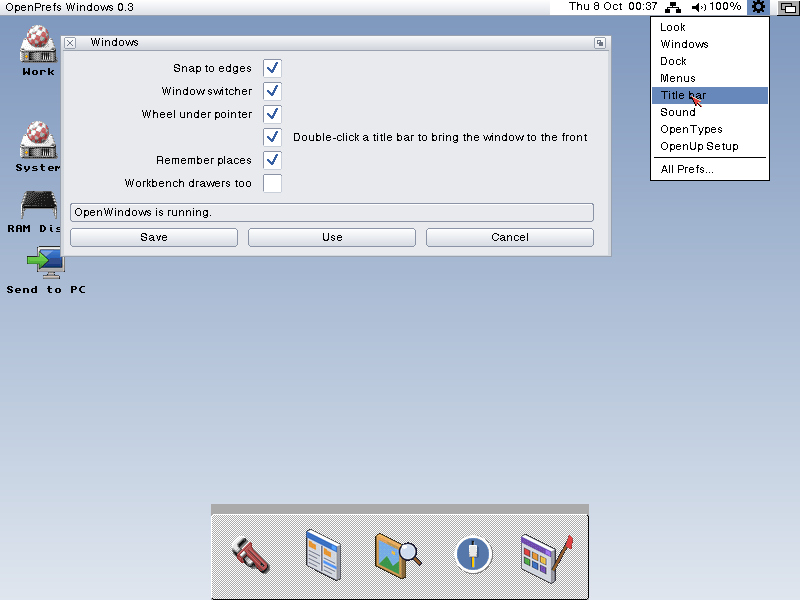

# OpenPrefs

Preferences editors for AmigaOS 3.x, as part of the Open family: GadTools
windows with Use, Save, Test and Cancel, that keep the OS's own settings
files wherever the OS already has one.

Since 17 October 2026 the editors below are **one program with one icon, OpenPrefs** (`SYS:Prefs/OpenPrefs`, and
`ROM:Prefs/OpenPrefs` in the OpenKick ROM): one window with the sections down the left and the page on the right
(a cycle gadget of sections on a 640-wide screen), each section the editor it was. The old names (`Look`,
`OpenLook`, `Windows`, `TitleBar`, `Menus`, `OpenDock`, `OpenSound`, `OpenInput`, `OpenGamepads`, `OpenDateTime`,
`OpenSerial`, `OpenTypes`, `OpenSystem`) open their sections and take their arguments as before; `OpenPrefs APPLY`
at boot is served by a small body, `C:OpenPrefs`. See [docs/combined-prefs](docs/combined-prefs/DESIGN.md), its
revision of 17 October.

| Editor | What it sets | State |
| --- | --- | --- |
| [OpenPrefs](docs/combined-prefs/DESIGN.md) | Every editor below as a section of one window: Theme, Screen mode (with Overscan under it), Pointer, Fonts, Colours, Backdrops (WBPattern), Workbench, File requesters, Windows, Title bar, Menus, IControl, Dock, Sound, Mouse and keys (the mouse, the keyboard and the keymap), Gamepads, Date and time, Serial, File types, System and Blanker (OpenBlanker's wait before the show) | 2.0 built 17 Oct 2026 (W48): one program, one icon; the old names as ROM: aliases and disk stubs; `OpenPrefs APPLY`; the folders a save needs made (asking first on SYS:). 21 Oct 2026: Screen mode with Overscan and IControl added, Input shown as Mouse and keys (written, host-tested; the stove build and a lab run next) |
| [OpenTypes](OpenTypes/DESIGN.md) | Which program opens each kind of file: the default icons, the icons files already have, and Open with... in Workbench's Tools menu | 0.1 built 5 Oct 2026: the window, the Shell commands, finding and changing icons, Undo (phases 1 and 2); Open with... next |
| [Look](Look/DESIGN.md) | OpenLook, the editor (Appearance in the combined preferences): ten tabs in one window. Theme (the OpenGadTools look: theme, light/dark/by the clock, accent, Lite, which screens and programs are themed, desktop profiles, focus), Pointer, Fonts, Colours, Backdrops, Workbench and File requesters (the OS's own `ENV:Sys` files, read and written with iffparse.library), then Windows, Title bar and Menus | OpenLook 1.2 built 12 Oct 2026, with Look 0.5.1: the six Appearance tabs, one PREF reader and writer with host tests; a pointer drawn on the Pointer tab, the icon frame and hidden devices on the Workbench tab, every page in 640 x 256 with Topaz 8; the pointer's acceleration next |
| [Menus](Menus/DESIGN.md) | OpenMenus, our own menus: how they open and work, delays, submenus, border, shadow, background, colours from the theme, keyboard control; takes over MagicMenu's settings | 0.1 written 6 Oct 2026; the OpenMenus engine is next |
| [Windows](Windows/DESIGN.md) | OpenWindows, how windows behave: snapping to edges, Amiga+Tab, the wheel under the pointer, remembered places, drawer sizes, and a double-click in a title bar bringing the window to the front | 0.5, with OpenWindows 0.6.1 (edge resize with an outline and one size at the button-up, edge grips and corners, drive titles with the name only, 10 Oct 2026) |
| [Title bar](TitleBar/DESIGN.md) | OpenTitle, the Workbench screen's title bar: the logo, free memory, clock, network icons, a cog at the right end that lists OpenPrefs's sections, and the taskspace, where other programs (Tata first) put their icons | 0.2, with OpenTitle 0.7 (17 Oct 2026: the cog always on, and on every other public screen with a title bar) |
| [Dock](Dock/DESIGN.md) | OpenDock, a dock on the Workbench screen: its place, size, buttons and see-through shelf; takes over ToolManager's, AmiDock's (AmigaOS 4) or AmiStart's | OpenDock 0.6 (10 Oct 2026: Size, Clear and Glass do what they say), with the Mac dock's layout (screenshots in its design) |
| [OpenUp Setup](Setup/DESIGN.md) | The first-start wizard: a desktop profile, the editors, screen, printer and network, and switches for what starts with the machine | 0.1 written 6 Oct 2026 |
| [Sound](Sound/DESIGN.md) | All of the Amiga's sound in one editor, in place of Sound and AHI prefs: the volume, Paula's and AHI's levels and mute (on AmigaChrome, live through the ACAHI board and shared with Cradle's mixer), who mixes AHI, the beep, AHI's units; and OpenSpeaker, the speaker on the menu bar | 0.1 built 6 Oct 2026, with OpenSpeaker 0.1; testing on an instance next |
| [Blanker](Blanker/DESIGN.md) | OpenBlanker, the screen blanker: after a while with no key or mouse, a show on a screen of its own (Gods and Angels, AmigaChrome's homage to the Amiga's makers and keepers) | Built |
| [Gamepads](Gamepads/DESIGN.md) | Game controllers, through OpenInput: the pads, live, a test view of every button and stick, mapping (built in or the user's own, made by pressing each button in turn), and the opt-in switch that lets older games see a modern pad as a CD32 pad or a joystick | 0.2, 9 Oct 2026: the Test view drawn as a controller; with openinput.library 1.2 |
| [System](System/DESIGN.md) | OpenSystem, how the system runs programs. First page, Stack: the adaptive stack's default cap and each program's own cap, handed to AmigaChrome's runtime | 0.1 built 13 Oct 2026: the Stack page, `OpenSystem APPLY` and `INFO` |

More of the Open family's editors may join it as sections of OpenPrefs: see [docs/combined-prefs](docs/combined-prefs/DESIGN.md).

Every editor opens in a **Simple** view, which puts the theme first and
shows the few settings people change. **View > Advanced** shows every
setting. The view is shared by all the editors, in
`ENV:OpenAmiga/PrefsView`.

Each editor has an Aminet readme beside its design (`OpenTypes/opentypes.readme`).

## Licence and credit

OpenPrefs is free software under the MIT licence (`LICENSE`, Copyright (c)
2026 AmigaChrome Team): anyone may use it, change it, fork it and ship it,
commercially too. The licence's one condition keeps the credit: the
copyright notice and the licence text stay with every copy and fork. We also
ask, as a courtesy rather than a condition, that a fork or a port say it is
based on OpenPrefs by the AmigaChrome Team.

OpenPrefs was created by the AmigaChrome Team, for AmigaChrome.

## Contributors

OpenPrefs is created and maintained by [SacredTrees](https://github.com/SacredTrees) with The AmigaChrome Team, copyright AmigaChrome Team. Everyone whose work it includes is credited in [`CONTRIBUTORS.md`](CONTRIBUTORS.md).
