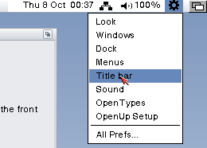
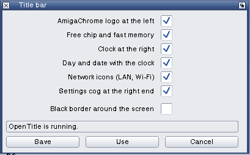
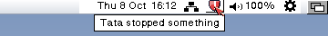

# OpenPrefs Title bar and OpenTitle

OpenTitle fills the Workbench screen's title bar: AmigaChrome's logo at the
far left, the free chip and fast memory after Workbench's title, and at the
right end the day, date and time, the network icons, OpenSpeaker's speaker
and a cog with the settings editors. OpenPrefs Title bar is its editor.
MIT, Copyright (c) 2026 AmigaChrome Team.

## What it shows

| Item | Where | Setting |
| --- | --- | --- |
| AmigaChrome's logo | The bar's far left, beside Workbench's own title only | `logo on` |
| Free chip and fast memory | Workbench's title format (the `WBTF` chunk of `ENV:Sys/Workbench.prefs`), so IPrefs shows it and Workbench updates it | `memory on` |
| Clock | Right end, left of the network icons | `clock on`, `clock.date on` |
| Network icons (0.4) | LAN and Wi-Fi from OpenSocket, between the clock and the speaker; a click shows the address and "Network settings..." | `network on` |
| Settings cog (0.5) | The bar's far end: right of OpenSpeaker, left of the screen's depth gadget | `cog on` |
| Other programs' icons (0.6, the taskspace) | Between OpenSpeaker and the network icons: Tata's shield, and any program that asks | (each program's own) |
| Black border | The display's border around the screen | `border.black off` |

The settings are in `ENV:OpenPrefs/TitleBar` (and `ENVARC:` on Save), one
`name on|off` a line. A line that isn't there keeps its default, so a file
written before 0.5 has the cog on. Save writes `ENV:` and `ENVARC:`; Use
writes `ENV:`; Cancel writes nothing. Either way the editor sends Ctrl-F to
the task of the public port `OpenTitle`, or starts `SYS:C/OpenTitle` when
something is on and it isn't running. From the Shell:
`TitleBar [FROM file] [USE] [SAVE]`.

## The tray: who sits where at the right end

Each program at the bar's right end keeps a file in `ENV:OpenMenus/Tray/`
holding `width order`. A lower order is nearer the bar's end; each program
places itself after the widths of those with a lower order and looks again
every two seconds, so the row closes up when one is switched off or isn't
installed. OpenMenus' own bar (at an edge) keeps room for the sum.

| Order | Program | File |
| --- | --- | --- |
| -5 | OpenTitle's cog | `Cog` |
| 0 | OpenSpeaker | `Speaker` |
| 1 to 4 | Programs' icons in the taskspace (Tata is 2) | the icon's name, e.g. `Tata` |
| 5 | OpenTitle's network icons | `Network` |
| 10 | OpenTitle's clock | `Clock` |

With the menu bar in the screen's title bar (the default), the first item
sits two bar heights in from the right edge, clear of the depth gadget.

## The see-through bar (OpenTitle 0.7.5, 25 October 2026): waits on Intuition

The user, 24 October 2026, 21:25: "make the title bar translucent until moused over then it goes its blue colour"
(Salvor's OS list, item 61).

**What it is meant to do.** On a screen the compositor draws, the bar's background rests at 40% opacity, so the
backdrop shows through it. The title, the depth gadget, the clock, the tray's icons and the logo stay opaque. With
the pointer on the bar, or a menu open (the menu button held, or OpenTitle's own cog list or network panel), it goes
solid in about 150 ms. Once the pointer has left it stays solid for 300 ms, then fades back in about 300 ms.
Anywhere else (AGA, PAL, an 8 or 16-bit screen, classic layers) the bar is solid, as before.

**Why it waits.** The bar is Intuition's: it draws the background, the title and the depth gadget into the screen's
BarLayer with pens, and nothing tells a program when it draws them again. OpenLayers can make any layer translucent
(`SetLayerOpacity`) or let its own alpha count (`LAYERLOOK_ALPHA`, 32-bit screens). Done to the BarLayer from
outside, the first fades the title and the depth gadget with the background. The second hides the whole bar,
because pens leave an OpenRTG 32-bit pixel's alpha at 0. A copy of the title kept opaque over it would lag each change
of title by up to half a second. So the background's opacity has to come from Intuition. This call is proposed to
Team 4 and is not in Intuition yet:

| | |
| --- | --- |
| Call | `IntuitionControlA(screen, tags)`, the screen as the object (today it takes windows only) |
| Tag | `ICTRL_BarOpacity`, `TAG_USER + 0x41430003` (after `WA_Opacity` +1 and `WA_AlphaSurface` +2) |
| 0-255 | How solid the bar's background (fill or gradient, and its lines) is. The title, its shadow and the depth gadget stay opaque, and so do the menus, in their own layers. 255 is today's bar, exactly |
| `~0` | Asks; changes nothing |
| Answer | `0x100` \| the opacity before, when the bar takes it; 0 when it can't (classic layers, 8 or 16-bit, no bar) |
| Cost | A change composes the bar's area again and draws no more than the bar. A hover sends 12: 4 in 150 ms, then 8 in 300 ms |
| Kept | Through Intuition's own redraws of the bar (a new title, ShowTitle) |

Today's Intuition answers 0 for a screen, so OpenTitle 0.7.5 finds the screen can't and nothing changes.

**OpenTitle's part, ready for it.** OpenTitle makes the bar see-through only when all of these hold. The first
four are checked when its windows open; the last also every 2 s.

- It's the Workbench screen's own title bar, shown (not OpenMenus' bar at an edge).
- OpenLayers composites the screen: 47.102's `LAYERS_COMPOSE_WHY` answers 0.
- The screen has 32 bits a pixel.
- Intuition answers the query.
- A layer behind the bar covers it all, so there's something to see. **OpenBench's backdrop window starts under the bar**
  (`WA_Top` BarHeight + 1, openamigabench `desktop/openbench.c`), so today only the compositor's black (its backfill,
  colour 0) is behind the bar. OpenBench needs a backdrop strip there (below).

While see-through:
- **The fade** is `src/tb_fade.h`, plain C with host tests. A step applies the time since the last one to the state
  the last one found. So a fade starts from the step that sees the pointer arrive, and the wait before that step
  doesn't count.
- **OpenTitle's bar windows** (the logo, clock, network icons, cog and the taskspace's icons) are drawn as before,
  then keyed. Their layers get `LAYERLOOK_ALPHA`. A pixel in its row's bar colour takes alpha 0 while the bar is
  less than solid, so the bar shows round the glyphs at whatever opacity it has. It takes 255 once the bar is
  solid, so a title long enough to run under the tray stays hidden, as before. Every other pixel is opaque. The
  alpha goes in with `WritePixelArray(RECTFMT_RAW)`, which keeps an OpenRTG 32-bit pixel's top byte. Pens and
  `RECTFMT_ARGB` clear it.
- **The bar's colours** are read only while it is solid. A theme changed while it rests is seen the next time it
  goes solid.

**The setting.** `seethrough on|off` in `ENV:OpenPrefs/TitleBar`, on by default. The Title Bar page has a box for
it: **See-through until pointed at** (TitleBar 0.3.4, OpenPrefs 2.6). OpenTitle follows it on Ctrl-F, as it does
the other settings. `seethrough.opacity 10-100` (40 by default) has no box; it's for trying other levels.

**Cost.** At rest the loop wakes as it did before: every 100 ms while the pointer is on the bar, every 500 ms
otherwise. On each of those wakes it also checks the pointer's height, OpenTitle's own lists and the menu button
(input.device's `PeekQualifier`), and calls `CurrentTime`. Only during a fade does the loop wake every 40 ms. A
hover adds 13 wakes in all (`tests/run.sh` simulates the loop): 4 in, 1 at the grace's end and 8 out. Each is one
`IntuitionControlA`, and two of them re-key the bar windows (about 6 windows, each up to about 60 x 21 pixels). On a
screen that can't, nothing extra runs after the windows open: one flag test every 2 s.

The pointer arriving is seen at the next wake. From below the bar that can be up to 500 ms after it arrives, as the
cog's light is today. A menu opened with the pointer elsewhere is seen the same way.

**How 40% reads.** Measured on the host: the Background Pack's four designs, cut to 1920 x 1200 as the pack does,
with the bar's gradient (openintuition's glass look) mixed over the picture's top 21 rows. The figures are the
contrast of the white title against the mixed background, across the text rows:

| Design | Solid (median) | 40%: lowest / 5th percentile / median | 60%: 5th percentile / median |
| --- | --- | --- | --- |
| Prismatic light | 7.0 | 1.7 / 2.1 / 3.3 | 2.8 / 4.1 |
| Prismatic dark | 7.0 | 1.7 / 4.7 / 11.6 | 5.1 / 9.4 |
| Nebula dark | 7.0 | 2.0 / 7.7 / 12.2 | 6.9 / 9.6 |
| AC090-EX64 dark | 7.0 | 2.8 / 7.7 / 12.0 | 6.9 / 9.4 |

40% reads well on the three dark designs: the background goes darker than the solid bar, so the title gains
contrast. Prismatic light at 40% drops to a median of 3.3 (2.1 at the 5th percentile), which is weak for small
text. Both Prismatic designs have bright streaks near the right end, under the clock (the lowest figures). A light
backdrop (its `.tone` says light) would want about 60%. That is a follow-up once the bar is live; until then,
`seethrough.opacity` sets it.

**Not yet.**
- Intuition's call (Team 4).
- OpenBench's backdrop under the bar: a backdrop strip window over the bar's rows with the same backfill hook (its
  `bf_fill` already draws in screen coordinates), then `ShowTitle(screen, TRUE)` so the bar stays in front.
- OpenSpeaker's speaker (openamigaup) keyed the same way. Until then it is a solid box on the clear bar.
- Lab proof on a copy of Instance-32 (full12, RTG 1920 x 1200), once the call is there: screenshots at rest, while
  hovering and with a menu open; a PAL/AGA screen staying solid; the Shell run's cost.

## The cog always, and on other screens (OpenTitle 0.7, 17 October 2026)

Dale, 17 October 2026, 08:26: "The cog should be present on all standard screens so Workbench screen has it all
the time."

- **Always on the Workbench screen's bar.** The `cog on|off` line is kept in the file as it was (OpenPrefs's
  Title bar page writes it back unchanged) but is read no more, and the page has no switch for it. With every
  other item off, OpenTitle no longer quits on Ctrl-F: the cog stays.
- **The list is OpenPrefs's sections:** Look, Windows, Title bar, Menus, Dock, Sound, Input, Gamepads, Date
  and time, Serial, File types, System and Blanker, each running `OpenPrefs SECTION` (SYS:Prefs/OpenPrefs,
  else ROM:Prefs/OpenPrefs; hidden when neither is there); then Printers, Network, OpenUp Setup and Tata when
  they are there, and All Prefs....
- **Every other public screen that shows its title bar** (in the public screen list, not private, SHOWTITLE)
  gets the cog alone at its bar's right end: a borderless visitor window, opened while the screen has a window
  of its own and closed when it has none, so the screen's owner can close the screen. Its list opens OpenPrefs
  on that screen (`PUBSCREEN=`). Checked every second. Never on a custom screen that isn't public (a game's),
  nor on one without a title bar.
- The ROM's bar (amigachrome-guest common/openbar) does the same while OpenTitle isn't running.

## The cog (OpenTitle 0.5, 8 October 2026)

The user asked on 8 October 2026 for "a cog wheel in the workbench screen
bar, after the sound speaker and before the send back and forward". It lives
in OpenTitle, which already places the clock and the network icons, so it
costs one small window and no new process.

- **Look.** Drawn in the screen's DrawInfo pens, so it follows the theme on
  a true-colour screen and on AGA alike: the bar's detail pen on the bar's
  block pen; raised (shine and shadow lines) while the pointer is over it;
  filled (fill pen, fill text pen) while its list is open, as the speaker is.
  It is 13 pixels square on a bar 15 or more high, 11 or 9 on a lower one.
- **Click** it: a list opens under it (above it on a bottom or side bar),
  drawn as OpenMenus draws its menus: the editors that are installed, a
  line, and **All Prefs...**. The entry under the pointer is lit. A click on
  an entry, or Return on a lit one, starts it; Esc, a click elsewhere or a
  click on the cog closes the list; the cursor keys move the light.
- **The entries**, the same as OpenUpMenu's Tools > Preferences
  (openamigaup `src/openupmenu.c`): Look, Windows, Dock, Menus, Title bar,
  Sound, OpenTypes, OpenUp Setup, each shown only when `SYS:Prefs/<name>`
  is there (Sound only with OpenUp's `SYS:C/OpenSpeaker`, since
  `SYS:Prefs/Sound` is OS 3.2's own until OpenUp's replaces it), then
  **All Prefs...**, which opens the `SYS:Prefs` drawer.
- **Starting one** is a double-click on its icon: `OpenWorkbenchObjectA()`
  (workbench.library 44), so the icon's stack and tool types count. Without
  it, the program is run with `NIL:` for its input and output; the drawer
  needs Workbench.
- The window you were working in is active again after the list closes,
  and the bar keeps showing its title while the list is open.
- OpenTitle now waits on its windows and timer.device instead of sleeping:
  a click is answered at once, and it looks at the pointer ten times a
  second only while the pointer is on the bar (for the cog's light), twice
  a second otherwise.

## The taskspace (OpenTitle 0.6, 8 October 2026)

The user named the icon row at the bar's right end, beside the depth gadget,
the **taskspace**, when designing Tata (openamigatata `Design-Tata.md`):
Tata's icon goes "in what we will call the taskspace next to the screen
depth gadget, network and sound". OpenTitle already drew the row's own icons
and kept their places in OpenMenus' tray; 0.6 opens the row to other
programs through a small public API, so every icon there looks alike and
follows the theme.

The protocol is `include/taskspace.h` (version 1). In short:

- **Add.** A program sends a `TaskspaceMsg` (`TSC_ADD`) to OpenTitle's
  public port `OpenTitle`, found and sent to under `Forbid()`, with its
  icon's name, its order in the row (1 to 4), up to four pictures of up to
  16 x 13 pixels, a line of help and the name of its own public port.
  OpenTitle copies what it needs and replies at once.
- **The pictures** are one byte a pixel: 0 see-through, 1 the bar's text
  pen, 2 and 3 shine and shadow, 4 to 15 the program's own colours
  (`tsm_RGB`, matched with `ObtainBestPen`). Drawn on the bar's own colour,
  so a theme change or an AGA screen still looks right.
- **Change** the picture shown with `TSC_SET`; take the icon away with
  `TSC_REMOVE`.
- **OpenTitle draws** each icon in a box like the cog's: raised under the
  pointer, with its help under it after a moment (six tenths of a second),
  and keeps its place in the tray (`ENV:OpenMenus/Tray/<name>`).
- **A click** is sent to the program's port as a `TaskspaceEvent`
  (`TSE_CLICK`, with the icon's box, so a window can open under it). The
  program replies it. A click that finds the port gone drops the icon.
- **When OpenTitle ends** each program gets `TSE_GONE` and has two
  seconds to reply; it adds its icon again when OpenTitle is back (Tata
  tries every few seconds).
- OpenTitle keeps running while any program has an icon, even with all
  its own items off.
- **The cog's list** has a new entry, **Tata**, shown when
  `SYS:Prefs/OpenTata` (Tata until 10 October 2026) is installed.

## Tested

On a scratch OS 3.2.3 (AmigaChrome, OpenRTG 800x600, CGTriumvirate 13, the
Open light theme), with OpenUp 0.6.14 installed and these builds put in:

- The cog sits right of the speaker's "100%" and left of the depth gadget;
  off in the editor, the speaker, network icons and clock close up to the
  depth gadget within two seconds, and on again they make room.
- Hover lights it; a click opens the list with all eight editors and All
  Prefs...; the entry under the pointer is lit.
- Look, Windows, Menus, Title bar, Sound and OpenTypes each opened from the
  list, with no console window; All Prefs... opened the Prefs drawer.
- A second click on the cog, a click on the desktop, and Esc each closed the
  list, and the window that was active before was active again.

Not tested: OpenMenus' bar at an edge, an AGA screen (the drawing uses only
DrawInfo pens), and a Workbench older than 44.

0.6, on a scratch copy of an OpenUp 0.6.17 instance (OpenRTG 800x600, the
Open light theme) with Tata 0.1 (openamigatata):

- Tata's shield came up between the network icons and the speaker once
  Tata's start-up was over, and the row closed up around it: clock,
  network icons, Tata, speaker, cog.
- Its picture changed with Tata's state: blue while on, red for a minute
  after Tata stopped a program.
- The pointer over it raised it and showed "Tata stopped something" under
  it; a click opened Tata's window (Tata starts `SYS:Prefs/Tata`).
- The cog's list showed Tata with the other editors, and choosing it
  opened Tata's window.
- OpenTitle stopped with Ctrl-C took Tata's icon away (`TSE_GONE`);
  started again, Tata added the icon back within a few seconds.

Not tested in 0.6: an icon at an OpenMenus bar on an edge, and a program
that ends without `TSC_REMOVE`.

## 0.6.1: the timer's signal (8 October 2026)

**What went wrong.** OpenTitle waits for its timer, its port, the
taskspace replies and its windows together. When something other than the
timer woke it, it aborted the timer request and took the reply with
`WaitIO()`. That reply had set the timer port's signal after `Wait()`
returned, and `WaitIO()` leaves the signal set. So the next `Wait()`
returned at once, the new request was aborted, and so on, without end.
OpenTitle never waited again, and no task below priority 0 ran: OpenFTP's
transfers process, at -1, never started, so OpenFTP's window never
opened.

**What set it off.** Any message while the timer was pending. Tata's
taskspace icon sends the first one, so OpenUp 0.7.0 showed it whenever
Tata was installed, even with Tata off. A click on the clock or the cog
would do the same.

**The fix.** Only a request that came back by itself counts as time
waited, and the timer's signal is cleared after `WaitIO()`. The Look,
Menus and Dock editors had the same pattern while their "Test" counts
down, and clear it too.

**Tested** on a lab copy of Instance-11 (amigachrome's
`scripts/lab_instance.py`) with OpenUp 0.7.0's Tata, OpenFTP 0.1 and
Tata's `TataLowPri` test:

| OpenTitle | A priority -1 process | OpenFTP's window |
| --- | --- | --- |
| 0.6, Tata on | Never ran (OpenTitle went round about 11,000 times a second) | Didn't open |
| 0.6, no Tata | Ran after 100 ms | Opened |
| 0.6.1, Tata 0.4 on | Ran after 100 ms | Opened |
| 0.6.1, Tata 0.4 off | Ran after 100 ms | Opened; Tata's shield showed its help, and a click opened Tata's window |
