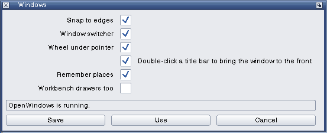
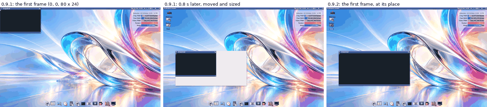
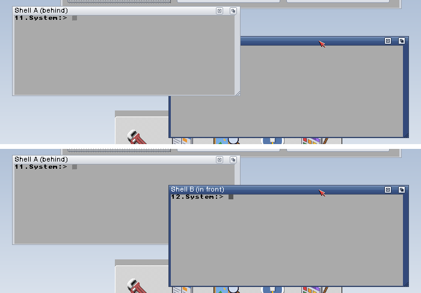

# OpenPrefs Windows and OpenWindows

OpenWindows is a commodity that changes how windows behave on Workbench and
every other screen. OpenPrefs Windows is its editor. OpenWindows watches the
input stream and moves, sizes and activates windows with the OS's own calls.
Since 0.7 it patches one pair of Intuition calls, OpenWindowTagList and
OpenWindow, so that a window with a kept place opens there (below); the
editor patches nothing. MIT, Copyright (c) 2026 AmigaChrome
Team.



## 0.1 (6 October 2026)

| Behaviour | What it does | Setting |
| --- | --- | --- |
| Snapping | A window dropped near a screen edge, or near another window's edge, lines up with it | `snap on 12` (the distance in pixels) |
| Halves | A window dropped with the pointer at the screen's left or right edge fills that half (resizable windows only) | `snap.halves on` |
| Switcher | Amiga+Tab brings the window at the back to the front and activates it; Amiga+Shift+Tab sends the front window to the back | `switcher on`, `switcher.key lcommand tab` (commodity words) |
| Wheel | The mouse wheel goes to the window under the pointer, which becomes active first | `wheel on` |
| Places | A program's window opens where it was last left, and at the same size when it can be resized | `places on`, `never <program>` lines |
| Drawers too (0.3) | Workbench's drawer windows are remembered the same way, with no Snapshot needed | `places.drawers on` |
| Double-click to front (0.4) | A double-click in a window's title bar brings it to the front. On by default | `doubleclick.front on` |
| Edges (0.5) | A resizable window is resized by dragging any edge but its title bar. On by default | `edges on` |
| Solid dragging (0.8) | A window is dragged by its title bar with its contents, not as an outline. Off unless asked for (the editor's "Drag windows with their contents, not an outline") | `drag.solid on` |
| Drive windows (0.6) | A drive's window is titled with the drive's name only: Workbench's "Work  70% full, 453MB free, 62.0MB in use" loses its usage part. On by default | `drive.title on` |
| Drawers | Workbench drawer windows open at least this big | `drawer 400 250` (0 0 leaves them) |
| Transparency and shadows (Windows 0.6.6, 17 October 2026) | layers.library's composited mode on RTG Workbench and public screens of 16 or 32 bits with OpenGPU: shadows under windows and menus, a window dragged at 75%, `WA_Opacity` (openamigagfx `docs/design/compositing.md`). On by default; read when a screen opens, so it takes effect at the Workbench's next reset | `composite on` |
| Gradient title bars (Windows 0.6.7, 17 October 2026) | Intuition's gradient look on true-colour public screens: title bars, the screen bar, frames and title gadgets in gradients, the window grey `#e8eaee` (amigachrome-guest `docs/design/gradient-title-bars.md`). On by default; off gives the look as before. Read when the Workbench opens, so it takes effect at its next reset | `gradient on` |

When the Workbench isn't composited, the page says why beside the switch (Windows 0.6.8, 18 October 2026): "Off on this screen: 8-bit", "switched off", "not RTG" (the native chipset), "pixel layout", "no GPU driver", "no OpenGPU" or "no memory". It asks layers.library 47.102 and up (`ComposeLayerInfo(li, NULL, LAYERS_COMPOSE_WHY)`, openamigagfx `include/graphics/openlayers.h`); with an older layers.library, or while the screen is composited, there is no line. The words go after the switch's own, or under them where that row is too narrow; in the two-column view of a small screen they go on the status line. Every RTG depth of 15 bits and up composites on ACRTG: OpenRTG gives a 16-bit mode RGB565 and a 32-bit mode XRGB32, whatever depth is asked, so "8-bit" is the usual reason.

The composited mode's look has lines of its own, which the editor keeps as written and has no gadgets for: `shadows on`, `shadow.size 8` (pixels), `shadow.strength 40`, `drag.opacity 75` and `inactive.opacity 100` (percent). A missing line is that default. OpenWindows 0.8.5 marks a window it drags itself (`drag.solid on`) as dragged for layers.library, so it is drawn at `drag.opacity` as Intuition's own drag is.

The settings are in `ENV:OpenPrefs/Windows`. Save writes `ENV:` and
`ENVARC:`; Use writes `ENV:` only; Cancel writes nothing. Either way the
editor sends Ctrl-F to the task of the public port `OpenWindows`, or starts
`SYS:Tools/Commodities/OpenWindows` when something is switched on and it
isn't running. From the Shell: `Windows [FROM file] [USE] [SAVE] [ADVANCED]`.

Places are kept in `ENV:OpenPrefs/WindowPlaces`, and in `ENVARC:` within
ten seconds of a change, as lines of `"program:title" left top width height`.
The program is the task's name, or the command a Shell runs. A window with
no IDCMP port, such as a console, is known as `window:<title>`. The title is
cut at its first digit, bracket or quote, so a title that shows a count or a
file name still matches (0.9.2: the title the window opened with, whatever it
shows later). Up to 128 places are kept (64 before 0.9.2), written the one
used longest ago first. Workbench's own windows (and, 0.9.2, OpenBench's) are left to Workbench, which has Snapshot, unless
"Workbench drawers too" is on (0.3, Dale 6 Oct 2026 for a 1920x1080
Workbench). Then each drawer is kept as `Workbench:<drawer>` and reopens
where it was left; the root window is never moved. Tested on a scratch
OS 3.2.3: the Work drawer was moved to 188,241 and reopened there after a
reboot. Forget all deletes the file and restarts OpenWindows.

**Placed before they open (OpenWindows 0.7, 10 October 2026).** The user
reported that windows open and then jump to their final position. Places
moved a new window at OpenWindows' next once-a-second look, after it had
opened where its program asked, so it was seen to open and then jump, for up
to a second. The user chose (10 October 2026) to place windows before they
open, which needs a patch: OpenWindows 0.7 patches `OpenWindowTagList` and
`OpenWindow` the way OpenLook already patches them, stacked with OpenLook's
patch whichever starts first.

- A window whose place is kept gets `WA_Left` and `WA_Top`, and `WA_Width`
  and `WA_Height` when it can be sized and the size is within its limits, in
  front of the program's own tags, and the same corner and size in a copy of
  its `NewWindow`. The program's own tags and `NewWindow` are not changed.
  (0.9.2: in front of a copy of the program's tags without its own corner and
  size; below.)
- The window is keyed as the once-a-second look keys it: the program (its
  task, or the command a Shell runs) and its title up to the first digit or
  bracket. A window opened without IDCMP is looked up by its task first (the
  shared-port way Workbench and many programs use) and then as `window`.
- One placing rule (`fit_place`) serves the patch and the look, so a window
  placed before it opens is never moved again by the look.
- The patch never waits. It reads the places with `AttemptSemaphoreShared`;
  when OpenWindows is changing them that instant, the window opens as asked
  and the look places it, as before. (0.9.2: under `Forbid()`; below.)
- It places nothing while the commodity is disabled in Exchange, for
  OpenWindows' own windows, or with Places off. Switching Places off takes
  the patch out.
- Leaving: OpenWindows takes the calls back only if they are still its own.
  If another program patched them after it, OpenWindows stays loaded and
  passes every window through, as OpenLook does in the same case, and says
  so in the Shell.
- The once-a-second look stays for windows the patch could not place (a
  public screen it couldn't lock, a window sized by its inner size, which is
  moved but not sized). (0.9.2: the look moves nothing; below.)

**Placed before they open, every time (OpenWindows 0.9.2, 24 October
2026).** The user: "OpenWindows: we need to make sure it reads the saved
position before it renders the window. Right now it jumps from one location
to another." Reproduced in a lab copy of Instance-32 (the open ROM,
OpenWindows 0.9.1, OpenBench 0.1.29 and its own `WindowPlaces`), with every
distinct frame of the RTG screen read back to back while each window opened:

| Window | 0.9.1: its first frame, then | Why |
| --- | --- | --- |
| The Shell: NewShell with the Shell icon's WINDOW, and the dock's Shell | 0,0 640 x 130, then within the second at its kept place, 145,523 853 x 421 | the CON: handler gives `WA_Left` and `WA_Top` (and its size) in its tags. The patch put its own in front, and OpenIntuition reads a tag's last, so the program's won |
| The Shell on the next ROM (guest #472: a CON: window with no size is asked for by `WA_InnerWidth` and `WA_InnerHeight`) | 0,0 at 80 x 24, then 0.8 s later moved and sized | the same, and a window asked for by its inner size was only moved by the patch; the look sized it |
| A test program opening with tags, or with a NewWindow and tags | where it asked, then moved | the same |
| A NewWindow alone; an ExtNewWindow with no tag list | at its place (no jump) | the patch's copy of the NewWindow; its tags read after the Extension's |
| An OpenBench drawer (Work), with "Workbench drawers too" off | where OpenBench left it, then at a place OpenWindows kept for it long before | OpenBench marks its windows `WFLG_WBENCHWINDOW` up to two seconds after they open. A look before that took the drawer for a program's window and moved it to that place; a look after it took it for Workbench's and kept nothing, so the user's later moves (OpenBench keeps them itself) were undone each time |
| An ASL requester (RequestFile) | where ASL put it, then at its kept place | ASL opens the window with no title and gives it one after: the patch looked for `RequestFile:`, the look kept and placed `RequestFile:Probe file` |
| OpenMonitor, OpenCalc, Pointer prefs | at their places (no jump) | their tags give no corner of their own |

Not causes on Instance-32: nothing patched the calls after OpenWindows
(a probe found OpenWindows' code on top of both), and Places and the
commodity were on. Found on the way: the file held 64 places and was full,
and a new key took the place of the first in the file rather than the one
used longest ago, so `CON:AmigaShell` (third in the file) went after three new
windows; and the look held the places' semaphore across its moves and its
file writes, when the patch opened a window as asked (not seen in the lab).

What 0.9.2 does:
- **The program's tags in a copy, without its corner.** The patch's
  `WA_Left` and `WA_Top` (and `WA_Width` and `WA_Height` when the size is
  ours) come first, then a copy of the program's tag list, flattened (`TAG_MORE`,
  `TAG_SKIP`, `TAG_IGNORE`), without the program's own `WA_Left` and `WA_Top`
  (and `WA_Width`, `WA_Height`, `WA_InnerWidth`, `WA_InnerHeight` when the
  size is ours). An ExtNewWindow's Extension is copied the same way. So the
  patch's are the only placing tags, whether Intuition reads a tag's first or
  its last. The program's own tags and NewWindow are not changed. The copies
  are made on the opening task with `AllocVec` and freed after the call; a list
  of over 512 tags, or no memory, and the window opens as asked.
- **A window asked for by its inner size is sized too**, by its whole kept
  size, when it has a size gadget and the size is within its limits (the
  Shell's CON: window from guest #472, ReAction's windows). One with no size
  gadget is moved and keeps its own size. A place kept for the Shell still
  wins over the 80 x 24 of guest #472.
- **The look moves nothing.** It notes each new window and keeps a place when
  a window is moved or sized. A window the patch didn't see open (a system
  requester OpenIntuition opens inside itself, a window open before
  OpenWindows started) stays where it opened. `drawer` still sizes
  Workbench's drawers after they open.
- **A window is known by the title it opened with.** The patch notes each
  window it saw open, and the look keys it by that title for as long as it is
  open (`src/places.c`, `place_key`). An ASL requester of RequestFile is
  `RequestFile:` whatever title it shows. A place 0.9.1 kept under a later
  title isn't found: such a window opens as asked once, and its place is kept
  again when it is moved. A window that closes and another that opens in its
  memory before the next look are told apart by the patch's note.
- **OpenBench's windows are Workbench's**, from the moment they open: placed
  and kept only with "Workbench drawers too" (`places.drawers on`), and
  otherwise left to OpenBench, which keeps its drawers' places itself.
- **The places are read under `Forbid()`**, and the look changes them only
  under `Forbid()` (a few bytes copied), so the patch never waits and never
  misses them. The semaphore is gone.
- **128 places, written the one used longest ago first**, read back in that
  order, so a new key takes the place used longest ago, across restarts too.
- **A window with no drag bar and an empty title is never placed**: such a
  popup was `window:` and took the place kept for another.
- **The look's log**: with `SetEnv OpenWindowsLog <file>` (read at the start
  and at Ctrl-F), the look adds a line for each new window ("placed before it
  opened", "no place kept", "not seen opening, left where it opened") and for
  each place kept.
- The cog's window (0.8.1) gets its corner the same way.
- `src/places.c` is pure C; `tests/test_places.c` runs it on the host: the keys,
  `fit_place`, the table, and each opener above, read by an Intuition that
  takes a tag's last (as OpenIntuition does) and by one that takes a tag's
  first. 0.9.1's tags fail the first and pass the second.

Lab (24 October 2026; a copy of Instance-32 on its ROM, and on a ROM of
every main with guest #472; every distinct RTG frame from before the window
opened). With 0.9.2 each window's first
frame is at its kept place and no later frame moves it: a test program by tags, by a
NewWindow, a NewWindow and tags, an ExtNewWindow, by inner size, with no
IDCMP and with no size gadget; the Shell from NewShell with the icon's
WINDOW, with no size (#151's icon) and from the dock; OpenMonitor; OpenCalc;
Pointer prefs; the ASL requester; the Work drawer with "Workbench drawers
too" on (at OpenWindows' place, where OpenBench asked for another) and off (at
OpenBench's own, not moved). The look's log has "placed before it opened"
for each, and no moves. A Shell moved to 300,200 700 x 400 and closed was in
`ENV:` and `ENVARC:` within ten seconds and reopened there, from NewShell and
from the dock.



Not yet:
- OpenBench's drawers have a sizing gadget of their own, added after they
  open, so with "Workbench drawers too" they are placed but opened at
  OpenBench's size.
- Tested on the open ROM only, not on OS 3.2.3's own Intuition; the host
  tests read the tags both ways.
- A title cut at its first digit still gives drawers such as `DH1:` and
  `DH2:` one key.

**Double-click to front (OpenWindows 0.4, 8 October 2026).** The user asked
for "double click to bring windows forward" as part of the Open tools, on by
default. Intuition brings a window forward only from its depth gadget, and
the common Amiga answer is a double-click: OS 3.2's ClickToFront commodity
brings a window forward on a double-click anywhere in it (Look's "Click to
front" turns it on). OpenWindows does it for the title bar only, where a
double-click means nothing to a program, so a double-click on a file in a
list or an icon in a drawer is left alone. It acts only on two presses of
the left button on the same window's drag bar (on the drag gadget and on no
other gadget: not close, depth, zoom or a program's own), no more than four
pixels apart, within the double-click time of Input prefs (`DoubleClick()`,
with the input events' own time stamps). A window already in front stays
where it is: sending a window back stays with its depth gadget and
Amiga+Shift+Tab, so a double-click never makes a window vanish. The presses
go on to Intuition untouched (the window is made active, a drag starts as
usual); OpenWindows only acts after them, so Workbench's icon double-clicks
and programs that use their title bar see what they always did. With
ClickToFront on too, both bring the window forward, which looks the same.
The editor's switch, in both views: "Double-click a title bar to bring the
window to the front".



**Resize from any edge (OpenWindows 0.5, 8 October 2026).** The look
approved that day has no size gadget: a resizable window is resized by
dragging any edge but its title bar, the sides, the bottom and the bottom
corners, as on today's desktops. OpenWindows does it without patching
Intuition:

- **The grab zone** (0.6.1) is 4 pixels outside the frame and the frame's
  own line, down both sides and along the bottom, below the title bar, and a
  5 x 5 square on each bottom corner. Nothing is drawn. The title bar's
  height only ever moves a window.
- **The input handler decides at the press.** It reads the screen's layers
  front to back with no lock (it runs on input.device's task and can't wait,
  as the wheel's test already does): the first window whose frame holds the
  pointer is the one under it, and only its own edge counts; a point just
  outside every frame in front of a window belongs to that window's edge. A
  press there is kept from Intuition (it becomes a plain move) and the main
  task is told. A backdrop, a borderless window and one without
  `WFLG_SIZEGADGET` are never grabbed, and a press with Shift, Ctrl, Alt or
  Amiga held is left to Intuition.
- **The main task sizes the window once** (0.6.1; 0.5 and 0.6 called
  `ChangeWindowBox` at every move, which froze the screen, see below): while
  the button is held an outline shows the box, from the box the window had
  at the press: the edge or corner held follows the pointer, the others stay.
  At the button-up one `ChangeWindowBox` follows. The window keeps to its own
  limits (`MinWidth` to `MaxWidth`) and to the screen. The window is made
  active.
- **The press is tested under the screen's layer lock.** The input handler
  can't wait, so it takes the lock with `AttemptSemaphore`; while another
  task holds it, the press goes to Intuition as before 0.5. The edges are the
  window's own box (`LeftEdge`, `TopEdge`, `Width`, `Height`), not a layer's,
  so a GimmeZeroZero window's inner layer and a requester never make an edge.
- **The resize pointer is off by default** (`edges.pointer on` asks for it):
  left-right, up-down, or the corner's diagonal, `pointerclass` images of
  OpenWindows' own, until the button comes up. A window's own pointer (one
  set with `WA_Pointer`, or a busy pointer) can't be read back, so after the
  drag the window would have the default one. The editor keeps the line as
  written; it has no switch for it.
- **Not yet:** the edge lit in the accent as the pointer passes over it (the
  mock-up's hover), which is the cue instead of a pointer: OpenLook draws the
  frame, so it comes with openworkbench.library.
- `edges on` (the default) in `ENV:OpenPrefs/Windows`; the editor's switch,
  in both views: "Resize a window from any edge but its title bar".

**0.6 (10 October 2026): the user's "it only lets us resize vertically".** On
Instance-32 (1920 x 1080, the Open light look, the size gadget off) a window
could be sized from its bottom edge but not from its sides. The edges were
tested in a lab, with pointer positions injected through input.device
exactly on the frame: right, bottom, left and both bottom corners were
grabbed and sized as designed, so the grab itself was sound. What stopped it
was the pointer. OpenRTG gave a mode 18 ticks a pixel and OS 3.2's Intuition
stops the pointer at 30000 ticks, so at 1920 pixels wide the pointer ended at
x 1666 (openrtg.library 0.13.1 fixes it: openamigartg #59): a right edge
beyond it could not be reached and a window could not be widened past it,
while 1080 rows are well inside the limit. The grab zone was also only six
pixels wide against a slim one-pixel frame, with the pointer's position
steered from the viewer; it is now ten wide, with corners that reach along
the edges. Lab: right edge grabbed 6 pixels outside the frame and pulled 60
wider, bottom 6 outside pulled 60 taller, left 4 outside, and both bottom
corners 10 pixels along an edge; each window box came out as set.

**0.6.1 (10 October 2026): "resize crashes the apps", and the whole screen
froze.** On Instance-32 an edge resize left OpenFiles with a blank body and
half a frame line, other programs crashed, and dock, bar and pointer stopped.
Reproduced in a lab at 1920 x 1080 with a test program that holds its layer
for 1.5 seconds while it redraws (a slow program) and one that quits on more
than four NEWSIZE in a second or on a size past its own limit (a fragile
one). The cause was 0.6's resize itself: it called `ChangeWindowBox` for
every move of the pointer, 150 of them in a short drag, so the program got
150 NEWSIZE and REFRESHWINDOW (Intuition's own sizing sends one NEWSIZE at the
end), and every one went through the input task, which waits on the program's
layer lock. With the slow program the input stream stood still for 82 seconds
(the lab's pointer commands did not return in 90).

- **An outline while the button is held, one size at the button-up.** The
  window is left alone during the drag; a two pixel outline of the box it
  would have is drawn inverted straight into the screen's bitmap, as
  Intuition's own sizing does, and moved with the pointer. At the button-up
  the outline is taken away and the window is sized with a single
  `ChangeWindowBox`: the program sees one NEWSIZE, the same as from its size
  gadget or a zoom. The slow program then got one NEWSIZE and the input
  stream never stopped (the same drag returned in 4.8 seconds); the fragile
  one, dragged 1200 pixels wider in 300 pointer events, got one NEWSIZE, at
  its own limit.
- **Limits are kept.** The box is cut to `MinWidth`/`MinHeight` and to
  `MaxWidth`/`MaxHeight`, where 0 and 65535 (a program that gave none) mean the
  screen's size, and to the screen.
- **No lock is held across a wait.** The input handler never waits and holds
  nothing between events: it takes the layer lock once, with
  `AttemptSemaphore`, to decide a press, and lets it go. The main task never
  holds a lock while it waits for anything. The button-up always ends the
  drag in the handler, whether or not the main task or the program has
  answered. A drag that gets no event for 8 seconds, or lasts 120, is
  dropped by the main task (the outline is taken away, the window is left as
  it was): the cover for a button-up that never arrives.
- **SIZEVERIFY** is not sent: Intuition's message cannot be sent by a
  program. A program that asked for it is sized as it is by a zoom or by a
  program's own `SizeWindow`, once.
- **Grab zones, as the user specified (10 October).** Nothing is drawn. A
  side is a strip four pixels outside the frame, with the frame's own line
  (one pixel); the bottom edge is the same along the bottom. Each bottom
  corner is a square of 5 x 5 pixels centred on the corner, two pixels
  outside the window and two inside, and holds both edges. Only the bottom
  corners: a window is never sized from its top, which is its title bar.
  The 16 pixel reach along an edge of 0.6 is gone.
- Lab (OpenWindows 0.6.1, OpenLook 0.7.5): right, bottom, left, bottom left
  and bottom right of a test window, the Work drawer, OpenFiles and a program
  with limits, one NEWSIZE each and the window as set; the Sound and Tata
  windows (no size gadget) stay as they are; OpenFiles redraws its two panes
  at every size. A resize now draws one frame in OpenLook instead of a
  hundred.

**Drive windows (0.6).** Workbench makes a drive's window title from its
format "%s  %lU%% full, %sB free, %sB in use" (the two spaces, the
percentage and the sign are what OpenWindows looks for). Workbench 3.2.3 has
no setting for it (its Workbench prefs only switch the fill gauge off, which
OpenUp's look steps do: `OpenUpTool WBGAUGE`). Once a second OpenWindows
cuts the text at its first space in the title of a Workbench window, in
place, in the string Workbench made (its memory stays its own), and has
Intuition draw the title again with `SetWindowTitles(w, title, ~0)`. Only
Workbench's windows (`WFLG_WBENCHWINDOW`) are looked at, so no other
program's title is touched. `drive.title off` (the editor's switch, in both
views: "Drive windows titled with the name only") leaves Workbench's titles
alone.

The size gadget itself is OpenLook 0.5's (`sizegadget off` draws it as the
window); it still works where it is.

**Views.** The editor opens in Simple, which shows the on and off switches. View >
Advanced (Amiga-A, or `ADVANCED` from the Shell) shows every setting. The
view is shared by all OpenPrefs editors as `simple` or `advanced` in
`ENV:OpenAmiga/PrefsView` (and `ENVARC:`).

Exchange lists OpenWindows and can disable, enable or quit it.

## 0.8 (10 October 2026): solid dragging

The user asked for an option to drag a window and its contents instead of an
outline. With `drag.solid on`, the input handler takes a left press on a
window's drag bar (the frontmost window under the pointer, in its title bar,
on its drag gadget and on no other gadget; read as the edges are, under the
screen's layer lock with AttemptSemaphore, so the input task never waits)
away from Intuition, as it does an edge, and the main task moves the window
with MoveWindow as the pointer moves, kept on the screen. At the button-up
the window is snapped (or fills a half) as an ordinary drag would be. A
double-click on the title bar still brings the window to the front. Qualifier
keys leave the press to Intuition, so Amiga-drag and the rest are as before.
A window moves with no NEWSIZE or redraw from its program: the layers move
its contents.

## The editor in 640 x 256 (Windows 0.6.5, 12 October 2026)

Inside OpenLook (1.1) the page was wider than a 640-wide screen in Topaz 8,
for its four long switches, and its Advanced view was taller than 256 lines.
Now the four long switches stand with their boxes at the page's left edge
when the column would make the page wider than 620 pixels, and in the column,
as before, everywhere else. On a screen under 400 lines the Advanced view puts
the short switches in two columns (Snap to edges and within, Window switcher
and its key, Remember places and Forget all, Never for on the left; Fill a
half, Wheel under pointer, Workbench drawers too, Drawers at least on the
right) with the four long ones across the page between them. Measured on a
PAL High Res Workbench in Topaz 8 (OpenLook 1.2): Simple 628 x 253, Advanced
628 x 245; the stand-alone editor's Advanced view is 628 x 245 too. On the
1920 x 1080 screen both views are as they were.

## Tested

Tested on a scratch OS 3.2.3 on AmigaChrome (OpenRTG 800x600), with input
sent as the instance window sends it:
- **Snapping.** A window dropped 12 pixels from the left edge went to 0. One
  dropped 6 pixels short of another window's right edge lined up with it.
- **Switcher.** Amiga+Tab and Amiga+Shift+Tab rotated three windows both ways.
- **Wheel.** Over an inactive window, the wheel made it active.
- **Places.** A Shell window moved to 28,168 reopened there after a reboot.
- **Editor.** Both views, and the view switch.

- **Double-click to front (0.4).** Two Shell windows, B partly behind A: a
  single click in B's title bar made it active and left it behind; a
  double-click there brought it to the front; a double-click inside A (not
  its title bar) made A active and left it behind. Switched off with Use,
  a double-click in A's title bar left it behind; switched on again, it
  came to the front. Double-clicks on Workbench icons opened them as before.

Not yet tested: halves, drawer sizes, and a program with a resizable window
of its own.

## For the OpenUp part

```python
ow = Part(top, "OpenWindows", "0.5", "OpenWindows: snapping, resizing from any edge, Amiga+Tab, the wheel under the pointer, window places, double-click to front")
ow.add("Prefs/Windows", (a.openamigaprefs / "Windows/build/os3/Windows").read_bytes(), "SYS:Prefs/Windows")
ow.add("Prefs/Windows.info", icons.icon(icons.WBTOOL, "page", stack=16384), "SYS:Prefs/Windows.info")
ow.add("Tools/Commodities/OpenWindows", (a.openamigaprefs / "Windows/build/os3/OpenWindows").read_bytes(), "SYS:Tools/Commodities/OpenWindows")
ow.line("startup Run >NIL: SYS:Tools/Commodities/OpenWindows")
ow.write()
```
