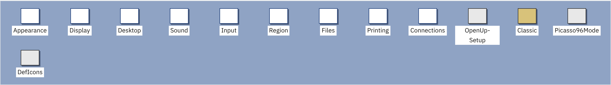
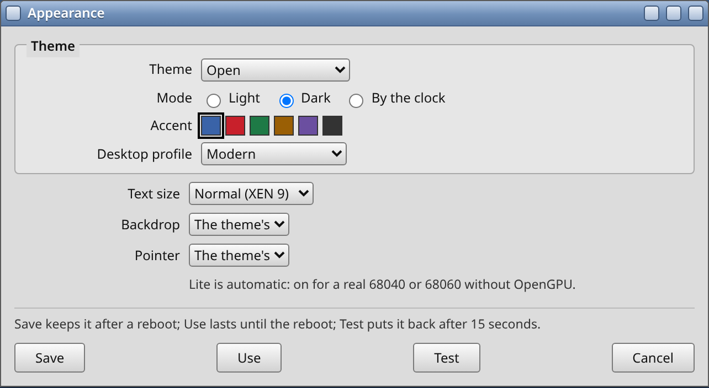
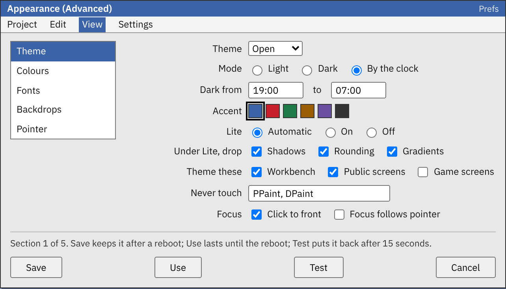
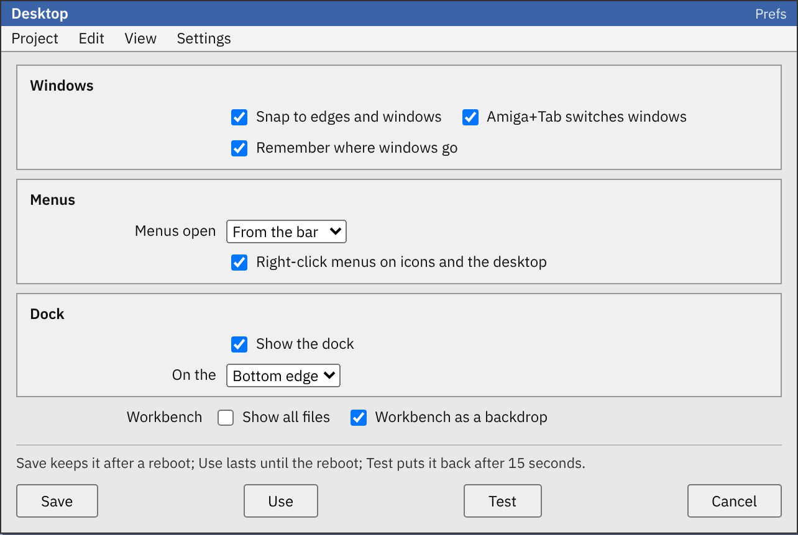
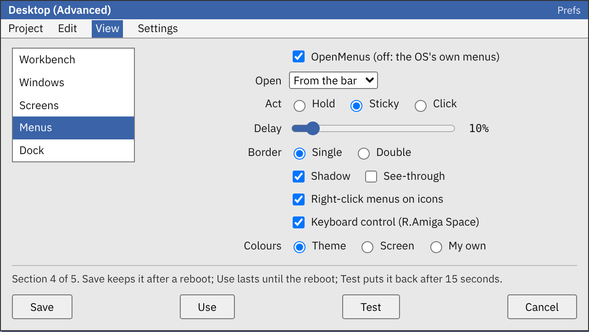
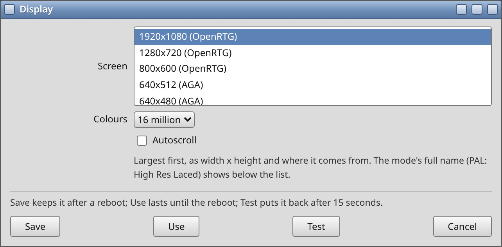
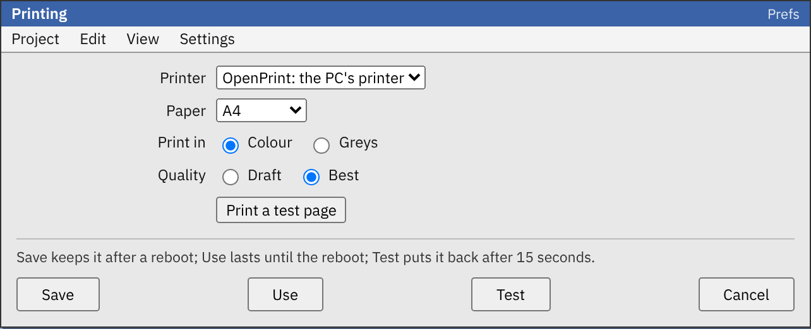

# Combined preferences (design)

**Since 17 October 2026: one app, OpenPrefs (the first revision below).** The rest of this design records the plan it replaces: nine OpenPrefs editors in place of twenty-three. Design taken 6 October 2026; P1 (the shared frame and Appearance) approved to build. Branded PDF: `Combined-prefs-design.pdf`; interactive mockup: `mockup.html`. MIT, Copyright (c) 2026 AmigaChrome Team.

The team was asked to design new preferences editors that combine similar settings and replace the old ones. Today a Workbench user meets twenty-three separate editors for settings that belong together: Font, Palette, Pointer, WBPattern and Look all change how the screen looks. We propose nine editors, each about one subject, built on one shared frame, and we keep every old editor working in a Classic drawer.

**In short**

- Nine editors: Appearance, Display, Desktop, Sound, Input, Region, Files, Printing and Connections. Together they replace 18 OS editors (17 from OS 3.2 plus AHI) and our own five OpenPrefs editors.
- Each one writes the same files the old editors write (`ENV:Sys/font.prefs`, `ENV:Sys/screenmode.prefs` and the rest), so every existing program keeps working, and a change made with a Classic editor shows up in the new one.
- Each opens in Simple: one page of the settings people change most. View \> Advanced shows a list of sections down the left, with every setting.
- The old OS editors move to `Prefs/Classic`, the pattern Dale chose for Sound today. Our own five become pages, and their Shell names keep working.
- Everything runs on a real 68040 with FPU and no OpenGPU. Rows a machine can't use are left out, not greyed.
- Dale took the five decisions on 6 October 2026, listed at the end.

## Revision, 24 October 2026: Printing

**Status:** the user's decisions of 24 October 2026 (15:02 and 15:3x: retire the legacy printing in favour of OpenPrint, and put the paper settings on an OpenPrefs "Printing" page), written (`Printing/src/printing.c` and `pr_prefs.c`, `PRINTING`, OpenPrefs 2.4; host tests in `Printing/tests/`). Not built yet. Where this section and the older ones disagree, this one wins.

- A **Printing** section in the last group, after Serial: the paper size (A4 first, then the other sizes printer.prefs can hold), lines a page, the left and right margins in columns, pictures horizontal (OpenPrint turns the page to landscape) or vertical (turned onto an upright page), and the density (1 to 7; OpenPrint's driver prints pictures at 72 to 1200 dots to the inch). It shows which driver and port printer.prefs names, and doesn't change them. Save, Use and Cancel; no Test, as a test would print.
- It replaces the paper parts of the OS's Printer and PrinterGfx editors, which openamigaup's OpenPrinter part archives. Unit 0's `ENV:Sys/printer.prefs` (PTXT) and `printergfx.prefs` (PGFX) are read and written with Look's PREF reader (`pf_iff.c`); every other chunk and byte (the driver, the port, PUNT, PDEV, pitch, spacing, quality, shading) is kept as the file has it. A file is written only where its bytes change.
- With no file, it makes the one the OpenPrinter part makes (OpenPrint's driver on `oapspool.device`) when OpenPrint's driver is in `DEVS:Printers`, else printer.device's no-file state (the generic driver on the parallel port); and only when a setting in that file changes. The OpenPrinter part writes the files only where there are none, so the page's settings survive an update.
- `OpenPrefs PRINTING PAPER A4 LINES 66 LEFT 5 RIGHT 75 PICTURES HORIZONTAL DENSITY 2 USE` sets them from the Shell.

The sections are now 23.

## Revision, 24 October 2026: Icons

**Status:** the user's request of 24 October 2026, 15:37 ("a page or tab in Preferences for this"), written (`Icons/src/icons.c`, `ICONS`, OpenPrefs 2.3). Where this section and the older ones disagree, this one wins.

- A new **Icons** section in the look group, after Workbench: where labels go (close to the picture, the default, or below the picture's whole box as OS 3.2.3), the label gap (0 to 8 pixels, 2 by default), the column grid's standard cell (Auto, from the icons, or a size), whether icons let go of on the desktop snap to the grid (on), the desktop's Clean Up order (name, kind, size or date), whether the desktop's columns fill down the left (the default) or the right, and a button to the Fonts page, whose Workbench icon text font the labels are in. Save, Use, Test and Cancel as on the other pages.
- A page of its own rather than a tab of Workbench's: OpenPrefs's sections are one list of pages, each with its own Save, Use, Test and Cancel and no tabs inside them, and Workbench's page is full. The Workbench page's "Labels close" box goes; OpenLook built alone keeps it.
- Two variables: `ENV:Sys/IconLabels` (icon.library's: `close`, `close 3`, `below`; no variable is `close`) and `ENV:Sys/IconLayout` (`cell=auto snap=on order=name columns=left`), read and written with opengadtools' `workbench/wb_grid.c`. OpenBench reads the desktop and its drawers again when either changes.

The sections are now 22.

## Revision, 21 October 2026: Mouse and keys, Screen mode with Overscan, IControl

**Status:** Dale's decisions of 21 October 2026, written (Display/, IControl/; host tests in their tests/). Where this section and the older ones disagree, this one wins.

- "fold mouse and keys into a single app": the Input section (OpenInput: the mouse, its acceleration, the keyboard's repeat and the keymap) is shown as **Mouse and keys**. `INPUT`, `MOUSE`, `KEYBOARD`, `KEYS` and `KEYMAP` all open it. This answers question 1 of the 10 October revision: one section for mouse and keys, Gamepads beside it.
- WBPattern stays in OpenPrefs as the Backdrops section (`BACKDROPS` or `WBPATTERN`).
- "overscan should be under screenmode": a new **Screen mode** section (`Display/src/screenmode.c`, `SCREENMODE`, `OVERSCAN` or `DISPLAY`) in the look group. The mode list, the width and height (each the mode's own or a number), the colours and autoscroll write `ENV:Sys/screenmode.prefs`; under them, for a chipset mode only, the text overscan's size and the standard overscan's rectangle for the mode's monitor write `overscan.prefs` (only when changed), and Reset gives the display database's own back. Still to check in a lab against OS 3.2.3's Overscan editor: the OSCN chunk's HStart..VStop and view position for a monitor that has no chunk yet, and the units of its rectangles.
- IControl, "fold into openprefs": a new **IControl** section (`IControl/src/icontrol.c`, `ICONTROL`) in the desktop group: the verify time-out, the keys that drag a screen, the four Amiga-key shortcuts, and avoid flicker, preserve colours, mode promotion, menu snap, the text gadget filter and windows off screen. OS 3.2's longer chunk is kept byte for byte. Its defaults with no file are still to compare with OS 3.2.3's editor in a lab.

The sections are now 21. The title bar's cog lists Screen mode and IControl, and Input as Mouse and keys.

## Revision, 17 October 2026: one app, OpenPrefs

**Status:** Dale's decisions of 17 October 2026, built (W48). Where this section and the older ones disagree, this one wins. It replaces the nine (and then ten) editors of the 6 and 10 October plan with **one program with one icon, OpenPrefs**; everything else stands: the shared frame, Simple and Advanced (`ENV:OpenAmiga/PrefsView`), each page writing the same files its old editor wrote, and OS 3.2.3's own editors staying on disk in `Prefs/Classic`.

- **08:18:** "We should just combine them into a single app, prefs editors that is."
- **08:24:** the boot's `SYS:Prefs/OpenSound USE` and `SYS:Prefs/OpenGamepads USE` (and System's `OpenSystem APPLY`) become one `OpenPrefs APPLY`, served by a small separate body so the boot doesn't unpack the app.
- **08:26:** "The cog should be present on all standard screens so Workbench screen has it all the time": on the Workbench screen's bar always, with no condition, in the ROM's bar (openbar) and the disk's (OpenTitle), and on every other public screen that shows a title bar; never on a custom (game) screen or one with no title bar. The cog's list opens OpenPrefs at its sections.
- **09:42:** a Save makes the folders it needs: ENV:'s and Env-Archive's subfolders without asking; when SYS:Prefs/Env-Archive (or SYS:Prefs) is missing, a Save from the window asks "The preferences folders are missing on SYS:. Create them?" (Create makes them, and `ENVARC:` when there is no assign; Cancel saves as Use does and says so on the status line); from the Shell it makes them and says what in one line.

**The window.** One window: the sections down the left, the page on the right, each page with its own status line and Save, Use, (Test,) Cancel along its foot, as the editor had. On a screen too narrow for the list beside the widest page (under 760 pixels wide, such as 640 x 256 with Topaz 8), the sections are a cycle gadget above the page, where OpenLook's tabs were. A click on another section keeps the page's changes as Use does, when the page has any (as OpenLook's tabs did, without the writes when nothing changed). The window keeps its place and only grows. Built on Look's tab frame (`Common/looktabs.h`, `LT_OP`), each page is its editor's own source with its main renamed; `OpenPrefs/src/opshift.h` moves its gadgets and drawing beside the list, so no page's layout code changed.

**The sections (19).** The look: Theme (Look), Pointer, Fonts, Colours, Backdrops, Workbench, File requesters. The desktop: Windows, Title bar, Menus, Dock. Sound and input: Sound, Input, Gamepads. The rest: Date and time, Serial, File types (OpenTypes), System, Blanker (new: OpenBlanker's one setting, `ENV:OpenPrefs/Blanker`). OpenUp Setup stays a wizard of its own; its buttons open OpenPrefs at a section through the old names. Room is left on the Windows page for W50's "Transparency and shadows" switch (`composite on|off` in `ENV:OpenPrefs/Windows`).

**The old names.** `Look`, `OpenLook`, `Windows`, `TitleBar`, `Menus`, `OpenDock`, `OpenSound`, `OpenInput`, `OpenGamepads`, `OpenDateTime`, `OpenSerial`, `OpenTypes` and `OpenSystem` each open their section, from the Shell with the editor's own arguments (`OpenSound USE` applies with no window, as before) and from Workbench. OpenPrefs reads the name it runs as. In ROM: they are aliases of `Prefs/OpenPrefs` in ROM:'s index, with no bytes and no icons of their own; on a disk, OpenUp puts a 500-byte stub of each name in SYS:Prefs, with no icon. `OpenPrefs [PUBSCREEN=name] [SECTION [arguments]]` and `OpenPrefs APPLY` are its own. Its version, 2.0, is higher than every editor's it replaces.

**An icon per section (Dale, 21 October 2026).** On a disk, each section has its own icon in SYS:Prefs again, as a 3.2.3 Prefs drawer shows one per editor; OpenPrefs keeps its own icon. The icons go on the old names' stubs (`OpenLook` stays hidden, as `Look` has the icon) and on nine new names, one for each section that had none: `OpenScreenMode`, `OpenPointer`, `OpenFonts`, `OpenColours`, `OpenBackdrops`, `OpenWorkbench`, `OpenFileRequesters`, `OpenBlanker` and `OpenIControl`, each a stub like the others. They carry the `Open` prefix so none takes the name of one of OS 3.2.3's own editors in the same drawer. The pictures are drawn and installed by OpenUp (its `icons/open`, ICONS.md's rule: two frames, something moves).

**APPLY.** `C:OpenPrefs` was the small body (in ROM:C a resident command, on a disk OpenUp's C:OpenPrefs): `OpenPrefs APPLY` runs Sound's `USE`, Gamepads' `USE` (when openinput.library is there) and System's `APPLY`, the editors' own code built without their windows; anything else it hands to the app. **24 October 2026:** no longer built (`salvor/Design-No-ROM-Volume-20261024.md`, section 8). An open ROM applies those three files at boot itself (intuition's prefs task, prefs.resource 47.101); on OS 3.2.3's own ROM OpenUp's User-Startup runs `SYS:Preferences/OpenPrefs APPLY`, the app's own APPLY. The old names' stubs aren't built either: OpenUp archives them, and `SYS:Preferences` has a project icon per page.

## Revision, 10 October 2026: OpenLook as the home of the look, and what folds where

**Status:** the user's direction of 10 October 2026, recorded; it revises the grouping below and leaves the rest of this design (one frame, Simple and Advanced, the files each editor writes, Prefs/Classic, the 68040 rule) as decided. Where this section and the older sections disagree, this section wins.

The user, 10 October 2026: the Pointer editor "crashes on our desktop" and "should be written in line with the open acceleration and placed as a tab in OpenLook"; then, for the rest of the drawer, that each group of OS editors folds into an Open app.

| OS editor(s) | 6 October design | 10 October direction |
| --- | --- | --- |
| Pointer | Appearance, Pointer section | **A tab in OpenLook**, rewritten: the pointer image and the velocity-aware acceleration of OpenInput's design goal (openamigainput `Design-Pointer-Acceleration.md`; OpenMouseAccel source in openamigaup `src/openmouseaccel/`) |
| Font | Appearance | **OpenLook** |
| Palette | Appearance | **OpenLook** |
| WBPattern | Appearance | **OpenLook**, inside the OpenLook framework |
| Workbench | Desktop | **OpenLook** (moves) |
| Asl | Files | **OpenLook** (moves): the file requester's settings sit with its theming |
| ReAction classes' look | not covered | **OpenLook** (the queued ReAction theming: listbrowser, string, button, layout, label in the theme's colours and screen font) |
| ScreenMode, Overscan | Display | **A new Open app in the OpenLook family**, combining the two (as Display) |
| Input, IControl | Input; IControl in Desktop | **Open apps** in the same way (open: one app or two, question 1) |
| Locale, Time | Region | **A new Open app** (as Region) |
| Printer, PrinterGfx, PrinterPS | Printing | **Redesigned to stitch alongside OpenPrint**, not a separate editor |
| DefIcons | left where it was | **Folded under OpenTypes**: the remaining default-icon functionality joins OpenTypes |

**What this means for the plan.** "Appearance" in the sections above is OpenLook's own editor (Look, in this repository), grown into tabs: Theme, Pointer, Fonts, Colours, Backdrops, Workbench, File requesters. P1 (the shared frame and Appearance) stays first and now carries the Pointer tab, which also ends the crash. Display and Region keep their shape as new Open apps. Files becomes OpenTypes with DefIcons inside it. Printing moves out of OpenPrefs into OpenPrint's settings. Desktop keeps Windows, Menus, Dock and IControl unless question 1 moves IControl.

**Every file rule above still holds:** each tab and app reads and writes the OS's own files (`ENV:Sys/pointer.prefs`, `font.prefs`, `palette.prefs`, `wbpattern.prefs`, `workbench.prefs`, `asl.prefs`, `screenmode.prefs`, `overscan.prefs`, `input.prefs`, `icontrol.prefs`, `locale.prefs`, the printer files), only what changed is written, and the OS editors stay in Prefs/Classic.

**Questions for the user**
1. Input and IControl: one Open app, or Input beside Gamepads and the pointer's acceleration, and IControl in Desktop?
2. The pointer's acceleration: shown in OpenLook's Pointer tab (the user's direction) and also from the Input app, or only in OpenLook?
3. The names of the new apps: Display and Region as in this design, or Open-prefixed names?
4. OpenPrint: the printer settings as a page of OpenPrint's own window, or a Printing editor that OpenPrint opens?

**Fix backlog from the same day**
- **Pointer (the OS editor) crashes on the Team's desktop** (Instance-32, OpenLook theme). Cause not yet found. Until the OpenLook Pointer tab replaces it, the crash is to be found and fixed or the editor kept in Prefs/Classic only.
- **Gamepads has no icon,** and **reports wrongly** (what it reports is to be confirmed with the user).

## What we found

OS 3.2's Prefs drawer holds seventeen editors, one per settings file, which is how the OS grew rather than how people look for a setting. AHI adds one more. Since 4 October we have added five of our own in DalsinAI/openamigaprefs: Look, Menus, Windows, Dock and OpenTypes, plus OpenUp Setup, which is a first-start wizard rather than an editor. Each new one made the drawer longer.

Several of these edit one subject from different sides. The colours of Workbench live in Palette, its font in Font, its backdrop in WBPattern, its pointer in Pointer and its theme in Look. How windows and menus behave is split between IControl, Workbench, Windows and Menus. Printer, PrinterGfx and PrinterPS are three windows for one printer. Locale and Time both answer "where and when am I".

The Sound design from earlier today already shows the answer: one editor for Paula, AHI and the PC side, writing both old files, with the old editors kept in `Prefs/Classic`. We have applied the same idea to the whole drawer.

## The nine editors

| Editor          | Replaces                                  | Sections in Advanced                                   |
|-----------------|-------------------------------------------|--------------------------------------------------------|
| **Appearance**  | Look, Palette, Font, Pointer, WBPattern   | Theme, Colours, Fonts, Backdrops, Pointer              |
| **Display**     | ScreenMode, Overscan                      | Screen mode, Overscan, Monitors (read only at first)   |
| **Desktop**     | Workbench, IControl, Windows, Menus, Dock | Workbench, Windows, Screens, Menus, Dock               |
| **Sound**       | Sound, AHI                                | Already designed in the AHI thread; included unchanged |
| **Input**       | Input                                     | Mouse, Keyboard, Gamepads (AmigaChrome only)           |
| **Region**      | Locale, Time                              | Country, Languages, Time zone, Clock                   |
| **Files**       | OpenTypes, Asl                            | Open with, File requesters                             |
| **Printing**    | Printer, PrinterGfx, PrinterPS            | Printer, Graphics, PostScript                          |
| **Connections** | Serial; fronts OpenSocket                 | Network (when OpenSocket is installed), Serial         |

**A tenth editor, System** (decided 13 October 2026): how the system runs programs, which none of the nine covers. Its first page is Stack, the adaptive stack's caps ([System/DESIGN.md](../../System/DESIGN.md)). It replaces no OS editor.

We considered putting Display inside Appearance. We kept it apart because a screen mode change reopens the Workbench screen and closes every window on it, while everything in Appearance applies at once. We also considered folding Serial into Printing; it fits better next to the network, since both are about talking to other machines. OpenUp Setup stays as it is, and its buttons open the new editors. Third-party editors such as Picasso96Mode, and DefIcons, which draws the default icons the Icon pack thread looks after, stay where they are.

<figure>

<figcaption>The Prefs drawer after the change: nine new editors (white), OpenUp Setup, the Classic drawer, and the third-party editors left in place.</figcaption>
</figure>

## How each editor looks

Every editor uses one frame: a GadTools window whose Project, Edit, View and Settings menus sit on the screen bar, with the page, a status line and Save, Use, Test and Cancel along the foot. Save writes `ENV:` and `ENVARC:`; Use writes `ENV:` and lasts until the reboot; Test puts things back after 15 seconds unless Use or Save follows; Cancel puts back what a Test changed. This is how Look, Menus and Windows already behave.

**Simple** is one page with the five to eight settings people change most, gathered from every section, with the theme first where there is one. **Advanced** adds a list of sections down the left; each section holds every setting of the editor it replaces, in that editor's own words where they are clear. The choice is still shared by every editor in `ENV:OpenAmiga/PrefsView`.

<figure class="half">

<figcaption>Appearance, Simple: theme, mode, accent and profile, then text size, backdrop and pointer.</figcaption>
</figure>

<figure class="half">

<figcaption>Appearance, Advanced, Theme section: every Look setting, including Lite and the never-touch list.</figcaption>
</figure>

<figure class="half">

<figcaption>Desktop, Simple: the four Windows switches, how menus open, the dock and two Workbench switches.</figcaption>
</figure>

<figure class="half">

<figcaption>Desktop, Advanced, Menus section: the Menus editor's settings as a page.</figcaption>
</figure>

<figure class="half">

<figcaption>Display, Simple: the modes this machine has, largest first, written as 1920x1080 (OpenRTG) down to 640x256 (AGA).</figcaption>
</figure>

<figure class="half">

<figcaption>Printing, Simple: one printer, paper, colour and quality, with a test page.</figcaption>
</figure>

**Screen modes (Dale, 6 October).** Display lists every mode by size, largest first, written as width x height with where it comes from: `1920x1080 (OpenRTG)`, `800x600 (OpenRTG)`, `640x512 (AGA)`, `640x256 (AGA)`. The source is the chipset or card that gives the mode (OpenRTG, Picasso96, AGA, ECS or OCS). Modes of the same size are ordered by colours, most first. The mode's full name, such as PAL: High Res Laced, shows below the list with its colours and scan rates.

The pictures are taken from the interactive mockup, drawn 640 pixels wide. We plan every page to fit a 640 by 256 screen, as the Menus editor does; that is an estimate until a built page is measured on an instance.

## The look: AmigaOS 4.1

Dale asked on 6 October that, theme-wise, we replicate how AmigaOS 4.1 looks. The pictures in this document are already drawn that way. We propose:

- **A new OpenLook theme in the manner of OS 4.1** (working name *Open 4*). It has shaded title bars, with the close gadget on the left and iconify, zoom and depth on the right. Buttons, cycle gadgets and lists are rounded and shaded, groups sit in titled frames, and the backdrop is deep blue. Menus stay on the screen bar, as on every Amiga.
- **The editors follow OS 4.1's prefs layout:** a page list with small icons down the left, titled groups on the page, and Save, Use, Test and Cancel along the foot. The editors are GadTools, and OpenLook draws the theme over GadTools, so they need nothing special to look this way.
- **Open 4 becomes the Modern profile's theme.** The Lite 68040 profile keeps the same shapes but drawn flat, with no gradients or shadows, as the Lite rules say. Classic 3.2 is untouched.
- **We draw every image ourselves.** The look is matched; no file, image or icon from OS 4.1 is copied, since those belong to Hyperion.
- Taller, shaded title bars need the frame and title sizes that Look's notes list as theme format 2. That work belongs to OpenLook (opengadtools), and Appearance's Theme page simply offers the new theme.

## Keeping old programs working

The rule we started from is that nothing that reads a settings file today may notice the change. So the new editors own no new formats for what the OS already stores:

| Editor      | Files it reads at start and writes on Use or Save                                                                          |
|-------------|----------------------------------------------------------------------------------------------------------------------------|
| Appearance  | `ENV:OpenGadTools/Look`, `ENV:Sys/palette.prefs`, `ENV:Sys/font.prefs`, `ENV:Sys/pointer.prefs`, `ENV:Sys/wbpattern.prefs` |
| Display     | `ENV:Sys/screenmode.prefs`, `ENV:Sys/overscan.prefs`                                                                       |
| Desktop     | `ENV:Sys/workbench.prefs`, `ENV:Sys/icontrol.prefs`, `ENV:OpenPrefs/Windows`, `ENV:OpenMenus/Menus`, `ENV:OpenDock/Dock`   |
| Sound       | `ENV:Sys/sound.prefs`, `ENV:Sys/ahi.prefs`                                                                                 |
| Input       | `ENV:Sys/input.prefs`; gamepads through the Cradle                                                                         |
| Region      | `ENV:Sys/locale.prefs` and the battery clock                                                                               |
| Files       | `ENVARC:OpenTypes/`, the default tools in `ENVARC:Sys/def_*.info`, `ENV:Sys/asl.prefs`                                     |
| Printing    | `ENV:Sys/printer.prefs`, `printergfx.prefs`, `printerps.prefs`                                                             |
| Connections | `ENV:Sys/serial.prefs`; OpenSocket's own files                                                                             |

- **Only what changed is written.** If you change the theme in Appearance, the palette, font, pointer and backdrop files are left exactly as they were. This keeps Save quick on a floppy-era machine and means a Classic editor's settings are never overwritten by accident.
- **The OS's own files keep their own chunks.** We read and write the IFF PREF files with iffparse.library and carry across any chunk we don't understand, so settings from a newer OS release survive.
- **The engines are told as now.** OpenLook, OpenWindows, OpenMenus and OpenDock get Ctrl-F on their ports, as the current editors send. Intuition and Workbench pick up the Sys files the way they do when the OS editors save them.
- **Shell use keeps working.** OpenUp Setup runs `SYS:Prefs/Look FROM <profile> SAVE`, and scripts may run the others. `Look`, `Menus`, `Windows`, `Dock` and `OpenTypes` stay as small names that start the right editor on the right section, with the same arguments. The OS editors keep their own names inside `Prefs/Classic`, and their `FROM` and `USE` arguments still work there.

## The network

Dale asked on 6 October that the network live in Connections when it is installed, and that OpenSocket, once set up, try to start with the machine unless it has been switched off. We propose:

- **The Network page appears when OpenSocket is installed,** and is left out otherwise. Simple shows how the machine is connected (through the PC on AmigaChrome, or an Ethernet or Wi-Fi card on a real Amiga), its address, and one switch: *Start the network when the machine starts*. Advanced adds the connection, DHCP or a fixed address, the name, DNS and Connect now.
- **Set up means it starts.** The first Save that leaves OpenSocket with a working setup turns on its line in OpenUp's startup block in `S:User-Startup`, so it starts at every boot from then on. Until then the line stays off, so a machine with no network does not wait for one at boot.
- **Switched off stays off.** Turning the switch off writes `;OFF ` before the line and lists it in `ENVARC:OpenAmiga/Startup.off`, the same switch OpenUp Setup uses, so an OpenUp reinstall keeps it off. The switch shows the same state in OpenUp Setup's startup page.
- **Starting never blocks the boot.** OpenSocket starts in the background with `Run >NIL:`. If no network answers, Workbench comes up anyway and the page says why on its status line.
- OpenSocket keeps its own settings files; Connections only edits them and the startup line.

## Real Amigas and the 68040

Every editor must run on a real 68040 with FPU and no OpenGPU, as all Amiga-side work must. We propose one shared frame, linked into each editor as plain C rather than a new library, so there is nothing extra to install. A section's gadgets are made only when that section is first shown, so opening Desktop costs about what opening Windows does today. Rows the machine can't use are left out: Gamepads appear only on AmigaChrome, Overscan only with a native chip screen, the Network page only when OpenSocket is installed, and the OpenRTG modes only with OpenRTG.

## How we would build it

P1

### The shared frame and Appearance

- Section list, Simple and Advanced, Save, Use, Test and Cancel, the PREF file reader and writer, and the Shell names.
- Appearance folds in Look, which exists, and adds the Palette, Font, Pointer and WBPattern pages.

Done when: a theme, a font and a backdrop changed in Appearance survive a reboot on a scratch OS 3.2.3 instance, and the Classic Font editor shows the same font.

**Status, 12 October 2026: built as OpenLook 1.1** (`Look/DESIGN.md`). Appearance is OpenLook's one window with ten tabs: Theme, Pointer, Fonts, Colours, Backdrops, Workbench and File requesters, then Windows, Title bar and Menus. The six new tabs share one frame (Simple and Advanced; Save, Use, Test and Cancel) and one PREF reader and writer (iffparse.library; host tests), write only a file whose bytes change, and carry every chunk and byte they don't know. Done when met in a lab copied from Instance-32: a theme, a screen font and a backdrop saved in OpenLook were there after the lab was stopped and started, and the Classic Font editor showed the same font; the files the tabs write are the bytes OS 3.2.3's own editors write for the same settings (the Pointer editor differs only in its reserved fields). **OpenLook 1.2, the same day:** the Pointer tab draws a pointer (fat bits, its three colours and its hot spot), and a drawing is written as OS 3.2.3's Pointer editor writes it; the Workbench tab shows the icon frame and the hidden devices, written byte for byte as that editor writes them; and every page of the editor fits a PAL High Res screen, 640 x 256, with Topaz 8 (measured in a lab: the tallest pages are 251 and 253 lines). Still to do: the pointer's acceleration (question 2 of the 10 October revision, and question 3 of OpenInput's `Design-Pointer-Acceleration.md`), the one Simple page for Appearance, and ReAction's look.

P2

### Desktop

- Folds in Windows, Menus and Dock, and adds the Workbench and IControl pages.

Done when: each of the five old files is read and written byte for byte the same as its old editor writes it, for the same settings.

P3

### Display, Input and Region

- Screen mode with OpenRTG and native modes, the mouse and keyboard, country, languages, time zone and the clock.

P4

### Files, Printing and Connections

- OpenTypes as a page beside the file requester settings; the three printer editors as one; serial, and the Network page with OpenSocket's start-at-boot switch.

P5

### The OpenUp part

- The new editors in `SYS:Prefs`, the OS editors moved to `SYS:Prefs/Classic` (and back again on uninstall), and OpenUp Setup pointing at the new editors.
- Tested on a real 68040 as well as on an instance before it ships.

Sound is built by the AHI thread on its own timetable and joins the frame when it is ready. Main Discourse owns the OpenPrefs editors and would build these too.

## Decisions taken

Dale answered all five on 6 October 2026, each with our recommendation.

**1. Nine editors, or one Settings app?** **Decided: nine** We recommended nine: each stays small enough for a 68040 and a 256-line screen, and each icon says what it does.

**2. Old editors into Prefs/Classic, or left beside the new ones?** **Decided: Prefs/Classic** We recommended Prefs/Classic, the same pattern as Sound.

**3. Simple as one page, or as the section list with fewer rows?** **Decided: one page** We recommended one page, as the Sound mockup does.

**4. Keep Amiga-A for Advanced, or move it to Amiga-Shift-A?** **Decided: keep Amiga-A** We recommended keeping it: no prefs editor has a Select all for it to clash with. Text editors that join the family later can use Amiga-Shift-A.

**5. Build Appearance first, or Desktop?** **Decided: Appearance first** We recommended Appearance: Look already exists, so it proves the shared frame with the least new code.

**Next:** build P1, the shared frame and Appearance, in DalsinAI/openamigaprefs once Dale says go. Nothing hooks Workbench until then.
